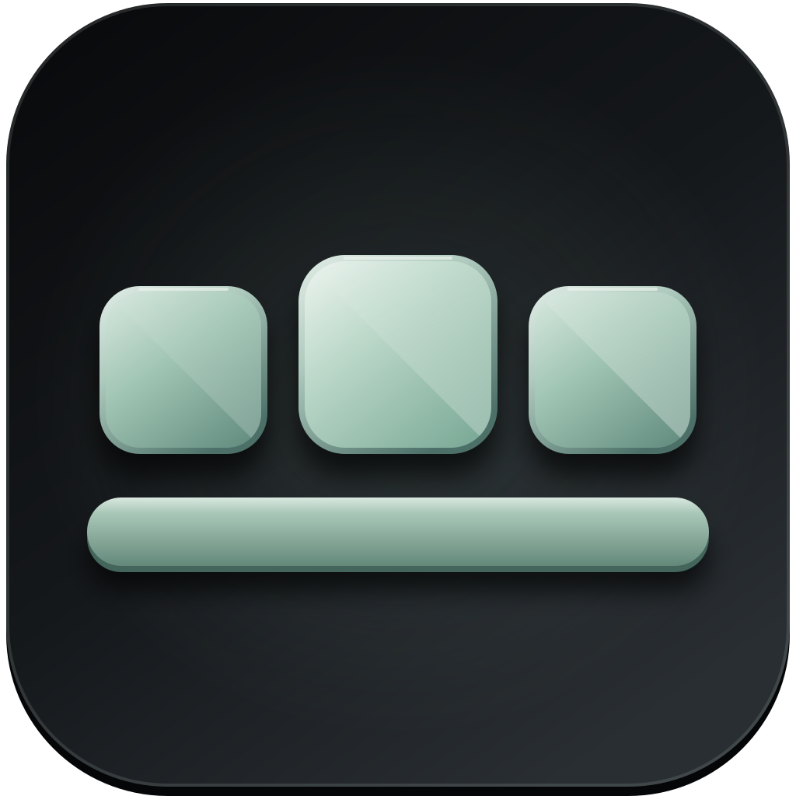
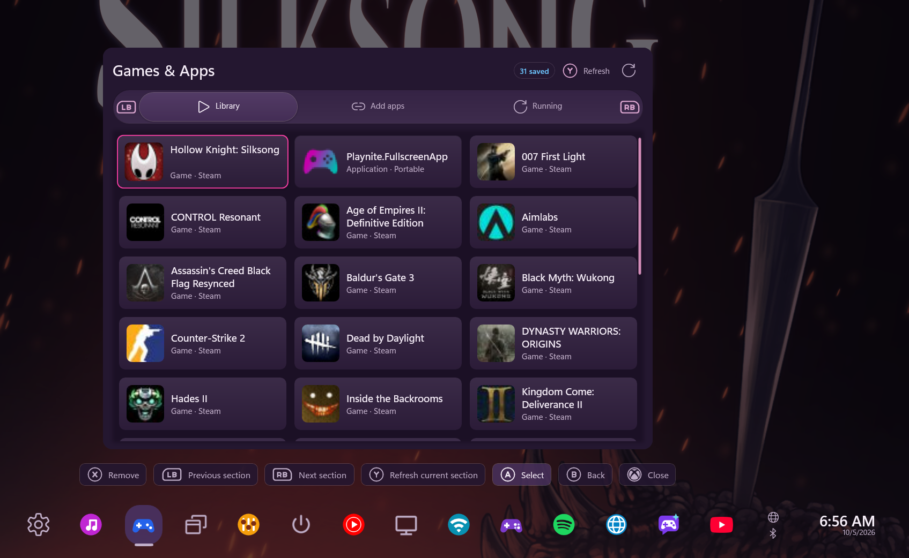
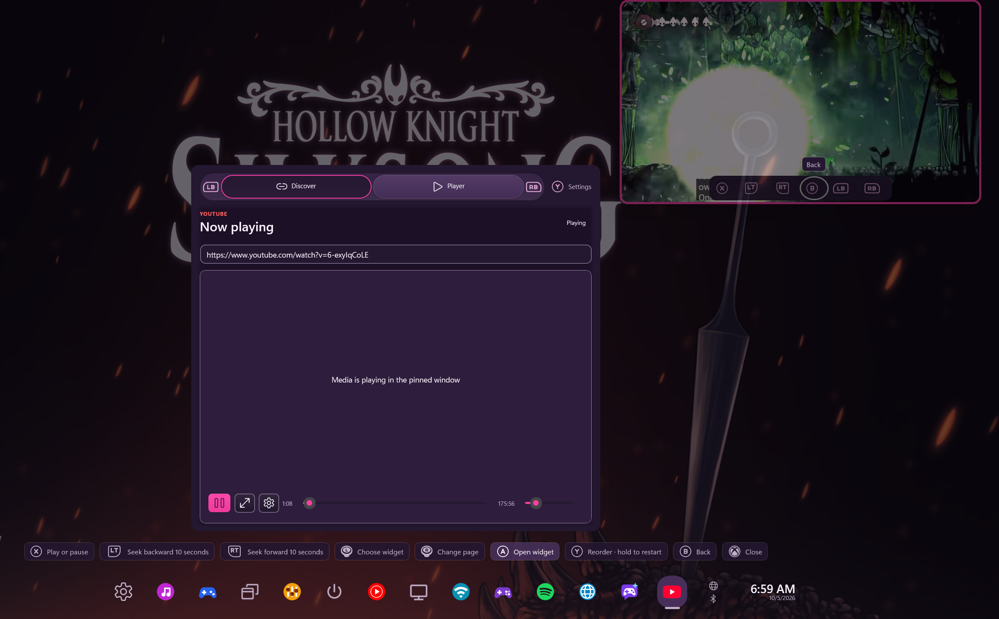

# WidgetRail

**Your PC, ready for a controller.**

WidgetRail brings controller-friendly controls to your existing Windows setup,
working alongside your desktop and games without entering a separate fullscreen
launcher. Control your PC's audio, applications, windows, connectivity and power.
Bring your services through native widgets, websites and personal webapps. Stay
in your activity with pinned content, connected widget actions and quiet notifications.

Start WidgetRail once, or enable startup at sign-in. Press **View + Menu** whenever
you need it, then hide the overlay to carry on. Keyboard and mouse work too.

Free and open source, with a C# framework for building additional widgets.

[Download](https://github.com/sandwi-dev/WidgetRail/releases) · [Installation](docs/users/getting-started.md) · [Documentation](docs/README.md) · [Build a widget](docs/developers/widget-quickstart.md)

*Illustrative screenshot from an earlier build; current controls may differ.*

## Quick start

Requires **Windows 10 build 19041 or newer, or Windows 11, x64**. WidgetRail is
preview software. This README describes the source version; check the release
notes for what is available in each download.

1. **Install and launch WidgetRail.** Get the **Production** installer from
   [GitHub Releases](https://github.com/sandwi-dev/WidgetRail/releases), run setup,
   then open WidgetRail from Start.
2. **Open the overlay.** Press **View + Menu** together. Navigate with the D-pad or
   left stick and select with A; follow the on-screen button hints.
3. **Adjust an app's volume.** Select **Audio Mixer**, choose an application that
   is playing audio, and adjust its volume. Approve access if prompted.
4. **Carry on.** Press **View + Menu** again to hide WidgetRail and return to your
   game or desktop.

**Bare** starts with Settings and Catalogue; install Audio Mixer from Catalogue
before following the volume example above. Both bundles support the same widgets.

To make it available each session, select **Start WidgetRail when I sign in**
during setup. It starts quietly; the shortcut opens it when you need it. Windows
**Settings → Apps → Startup** can enable or disable an existing startup entry.

Guide/PS can be selected as an alternative shortcut in **Settings → Controllers**.
For display size, use **Settings → Appearance → Interface size**; text size is
under **Accessibility**. More setup can wait until after your first useful action.

[Installation and Windows setup](docs/users/getting-started.md) · [Controller and keyboard controls](docs/users/controls.md) · [Customization](docs/users/customization.md)

## Everyday uses

| What you want to do | Where to go |
| --- | --- |
| Turn down a loud app or change audio devices | Audio Mixer |
| Launch a game or application | Games & Apps |
| Switch to another window | Task Switcher |
| Pause or skip media reported by Windows | Now Playing |
| Adjust network connections or put the PC to sleep | Network Controls or Power |
| Browse a page, or keep supported content visible while playing | Browser and widget pinning |
| Save a screenshot or short clip, with optional supported application audio | Capture Library |

Pin a supported video or compact widget, then hide the main overlay. Move, resize
and adjust the pin with the controller. Available pinned views depend on the
widget. [Pinning guide](docs/users/pinning.md).

*Illustrative screenshot from an earlier build.*

## More than quick controls

| Capability | What you can do |
| --- | --- |
| [Connected widgets](docs/users/connected-widgets.md) | Open supported content and actions in another widget or an eligible existing pin. |
| [Controller-ready browser](docs/users/browsing.md) | Navigate webpage controls, point, scroll, drag, zoom and type. |
| [Personal webapps](docs/users/webapps.md) | Add websites to the rail with their own persistent sign-ins and preferences. |
| [Notifications](docs/users/notifications.md) | Receive supported updates without losing controller focus; choose banners, list entries or silence. |
| [Live pinned surfaces](docs/users/pinning.md) | Keep supported pages, video and compact controls visible while using something else. |
| [Browser extensions](docs/users/extensions.md) | Enable supported extensions only in the profiles where you want them. |

[Try the everyday workflows](docs/users/everyday-workflows.md) · [What keeps running and what is saved](docs/users/lifecycle.md)

## Add widgets

Open **WidgetRail Catalogue** to discover widgets, see their setup requirements,
and review an installation. It is also reachable from **Settings → Widgets**.
Service integrations may need a separate account, key or companion before use.

| Widget | Setup to know about |
| --- | --- |
| [PoE1 / PoE2 Path of Building](samples/PobCompanion/README.md) | Build planning works locally; trade features use sign-in on the official trade website. |
| [Playnite Library](samples/PlayniteLibraryWidget/README.md) | Playnite; guided setup installs/connects the separate Bridge integration and saves its token. Setup may restart Playnite. |
| [Spotify](samples/SpotifyWidget/README.md) | Your Spotify developer app; Premium for streaming and playback control. |
| [YouTube Video](samples/YouTubeWidget/README.md) | Google API key for search; public video links work without a search key. |
| [YouTube Music](samples/YtMusicWidget/README.md) | Chrome/Edge sign-in for your personal library; supported public search/playback can work without it. Unofficial integration. |
| [Game Help](samples/GameHelpWidget/README.md) | Your Gemini API key; provider quotas and charges apply. |
| [Discord](samples/DiscordWidget/README.md) / [Twitch](samples/TwitchWidget/README.md) | Website sign-in for account features; website compatibility varies. |
| [Display Controls](samples/DisplayProfilesWidget/README.md) | Supported display hardware and permission for display controls. |

Full-access packages require explicit approval because they run with your Windows
account's permissions. Read the widget's requirements before installing.
[Catalogue and installation guide](docs/reference/widget-marketplace.md).
See [integration setup and recovery](docs/users/integrations.md) for verification,
reconnection and credential cleanup.

**Updates:** automatic app-update checks can notify you, but downloading and
installing remain your choice. Open **Settings → About & troubleshooting → App
updates** for the app, or **Catalogue → Updates** for widgets. See the
[app update guide](docs/reference/app-updates.md) for the current installer flow.

## Compatibility

- Xbox-compatible controllers and native DualSense over USB or Bluetooth are
  supported. On-screen hints follow the detected controller.
- Windowed and borderless games offer the most reliable overlay and pinning
  experience. Exclusive fullscreen can hide desktop overlays.
- Windows foreground restrictions and other controller shortcuts can interfere.
  WidgetRail does not automatically change Game Bar or Windows shortcut settings.
- Optional Exclusive control requires additional drivers. Hardware, service
  accounts and provider permissions determine which features are available.

[Compatibility and limitations](docs/users/known-limitations.md) · [Recommended Windows settings](docs/users/getting-started.md#recommended-windows-settings) · [Troubleshooting](docs/users/troubleshooting.md)

## Build a widget

Use the **C# SDK** to describe your interface and actions. WidgetRail provides
native rendering, responsive layout, controller navigation, shared text entry,
themes and widget lifecycle support. You do not need to build the native host to
write an ordinary widget.

The CLI includes templates, validation, previews and packaging. Explore
[SDK Gallery](samples/SdkGalleryWidget/README.md), a buildable source example, for
working controls and layouts.

[Your first widget](docs/developers/widget-quickstart.md) · [Authoring guide](docs/developers/widget-authoring-guide.md) · [CLI reference](docs/reference/cli-workflows.md) · [Build the app from source](docs/maintainers/building.md)

Connect widgets through [intents](docs/reference/widget-intents.md), or integrate
an external application through [local companion services](docs/reference/community-companion-services.md).

## License and contributions

The platform, SDK, first-party widgets and templates are **MIT-licensed**.
Third-party dependencies retain their respective licenses.

[Contributing](CONTRIBUTING.md) · [Issue tracker](https://github.com/sandwi-dev/WidgetRail/issues) · [Licensing](LICENSING.md)
