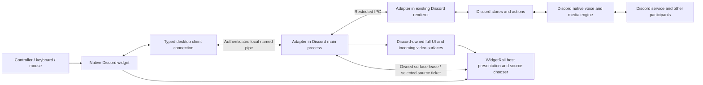

# Discord Desktop integration: architecture and complete migration plan

Created: 2026-10-27. **Cancelled by the user on 2026-10-28.**
The user chose to retain and refine the Discord integration already in main.
Do not continue this migration, run its remaining tests, install further adapter
builds or merge its experimental infrastructure without a new explicit request.
The sections below are preserved historical design/evidence, not active work.

The experimental worktree and passing fixtures remain available as references.
No cancellation cleanup resets or deletes unrelated/uncommitted work. The earlier
approved diagnostic Vencord bootstrap installation is a separate local change;
cancelling development does not restore it or authorize interrupting Discord.

This plan replaces further WebView streaming experiments with an investigation
and migration of the **whole existing WidgetRail Discord experience** to an
existing official Discord Desktop client on Windows. It is not a streaming-only
adapter, a new Discord client, or a promise that Electron exposes every required API.

## 1. Outcome and boundaries

The user keeps their installed Discord, its signed-in account, voice devices,
friends, servers and ordinary desktop UI. WidgetRail provides the controller-first
call/activity interface, channel search, shortcuts, settings, application chooser,
voice pin and incoming-video pin. Commands operate on the same call and streams
as the desktop UI. Closing WidgetRail does not close Discord or end its call/share.

Discord owns microphone capture, application capture/audio, codecs, encryption,
network adaptation, receiving, decoding and audio playback. WidgetRail must not
reintroduce its WebView2 outgoing frame pipeline behind a desktop-looking interface.
No Discord token, cookie, password, session database or encryption key is exported.

Full parity includes the existing in-widget full Discord page, not merely a button
that switches to an external application. External Discord is a recovery path,
not proof of parity. Inline desktop content and incoming pins are explicit early
feasibility gates. If they cannot be implemented reliably, present that limitation
before committing to the migration; do not silently downgrade the requirement.

Out of scope: rewriting Discord's native engine, shipping Discord binaries,
extracting its native modules into WidgetRail, bypassing quality eligibility,
building native text-chat/camera features absent from the current widget, or
restarting the abandoned WebView bitrate/profile experiment loop. Full Discord
UI continues to provide features beyond WidgetRail's native controls.

The accepted 0.0.14 baseline and uncommitted 0.0.18 work remain recoverable.
The user reported no meaningful live improvement in 0.0.18; its synthetic FPS
results are not a successful desktop baseline or accepted remote-quality result.

## 2. Evidence and what remains a hypothesis

Repository inspected at `23d542cb`, branch `codex/discord-native-prototype`, with
existing uncommitted work preserved:

| Source | Confirmed current behavior / architectural consequence |
| --- | --- |
| [Current feature inventory](../samples/DiscordWebViewWidget/README.md) | Call/activity, picker, audio controls, pins, sharing, saved preferences and diagnostics all need a disposition below. |
| [Session interface](../samples/DiscordWebViewWidget/DiscordSession.cs) | `IDiscordSession` exposes `WebSessionReference`, browser microphone admission and WebRTC receiver negotiation. It is not transport-neutral. |
| [Widget lifecycle](../samples/DiscordWebViewWidget/DiscordWebViewWidget.cs) | SDK model/resources/navigation/collections/pin handles already own generic presentation. A widget loop polls at 2/5 seconds and renews its receiver. Desktop adapter events can replace this polling. |
| [Views](../samples/DiscordWebViewWidget/DiscordWebViewWidget.Views.cs) | Both full Discord and the incoming pin are currently actual `UI.WebView` surfaces. Replacing only command transport loses these features. |
| [Sharing](../samples/DiscordWebViewWidget/DiscordWebViewWidget.Sharing.cs) | State contains WebView session and capture tickets. Desktop shares need provider-owned broadcast identity instead. |
| [Voice controls](../samples/DiscordWebViewWidget/DiscordWebViewWidget.VoiceControls.cs) and [stream audio](../samples/DiscordWebViewWidget/DiscordWebViewWidget.StreamAudio.cs) | Participant audio, stream audio, device controls and stale-action guards are distinct and must stay distinct. |
| [Preferences](../samples/DiscordWebViewWidget/DiscordWebViewWidget.Favorites.cs) and [experimental preferences](../samples/DiscordWebViewWidget/DiscordWebViewWidget.Bandwidth.cs) | Existing account-scoped private-state/CAS mechanism is reusable; browser-specific encoder semantics are not. |
| [Old adapter client](../samples/DiscordNativePrototype/AdapterClient.cs) | Vesktop comparison uses development-only CDP. It is not a production connection to installed Discord. |
| [Web capture SDK](../src/WidgetSdk/WebCaptureStreams.cs) | Chooser and capture preparation currently require an owned WebSession. Desktop sharing needs selection without starting host capture. |
| [Window preview SDK](../src/WidgetSdk/WindowPreview.cs) | View-only, permission-bound; minimized/protected/resource-limited windows may fall back. It is not an interactive foreign-client surface contract. |
| [External-surface fixture](../src/OverlayFrontend.WinUI/Validation/ExternalSurfacePage.xaml.cs) | This tests WebView2 layering, not desktop Electron window hosting. Its name is not evidence that the required host API exists. |

Read-only local discovery found running official Discord processes under
`app-1.0.9265`, while an `app-1.0.9266` directory also exists. Discovery must bind
the selected running client, not assume the highest directory name is active.
No authentication/profile contents were inspected. No desktop internal command,
native source mapping, inline surface or video-pin path is runtime-proven yet.

Primary external references, inspected on the date above:

- [Discord media-engine overview](https://discord.com/blog/how-discord-handles-two-and-half-million-concurrent-voice-users-using-webrtc): historical description of native C++ media versus browser WebRTC. Useful architecture context, not a current private API contract.
- [Discord Windows capture](https://support.discord.com/hc/en-us/articles/9410427556375--Windows-Capturing-Application-Window-for-Screen-Share-and-Go-Live): platform-specific capture and fullscreen limitations. Desktop does not guarantee flawless sharing on every source.
- [Discord RPC](https://github.com/discord/discord-api-docs/blob/main/developers/topics/rpc.mdx): documented voice-related commands exist; the documented surface does not cover this complete integration.
- [Vencord patcher](https://github.com/Vendicated/Vencord/blob/main/src/main/patcher.ts) and [installer](https://github.com/Vencord/Installer/blob/main/patcher.go): precedent for loading an extension around the original application and restoring installation files.
- [Vencord custom plugins](https://docs.vencord.dev/installing/custom-plugins/) and [native plugin code](https://docs.vencord.dev/plugins/native/): custom plugins require a source build today; native helpers can mediate local IPC. Do not promise users can drop our plugin into an ordinary release.
- [Electron BrowserWindow](https://www.electronjs.org/docs/latest/api/browser-window), [WebContentsView](https://www.electronjs.org/docs/latest/api/web-contents-view), and [offscreen rendering](https://www.electronjs.org/docs/latest/tutorial/offscreen-rendering): precedents for cooperative windows and rendering. Current Electron documentation does not prove availability in Discord's installed runtime or compatibility with its native video renderer.

All private desktop bindings, installation coexistence and rendering choices
below are proposals requiring verification. Pin exact upstream revisions when
implementation starts; do not build against a moving documentation page alone.

## 3. Proposed architecture



The diagram separates small control/state messages from media. Outgoing audio and
video never travel through the named pipe or WidgetRail's web capture worker.
Incoming audio also stays in Discord. Visual integration presents desktop-owned
content; its exact implementation is gated in section 8.

### Components and ownership

1. **Discord widget:** domain presentation, shortcuts, account-scoped favorites,
   recent channels and user intent. Reuse native layout, theme roles and existing
   SDK navigation, operations, resources, collections and pin handles.
2. **Desktop connection library in the widget package:** framed IPC, version
   negotiation, bounded state subscription, typed commands and reconnect. It owns
   connection/session epochs once; widget feature files do not each manage them.
3. **Desktop adapter main module:** identifies the exact Discord renderer,
   validates local commands, owns the pipe connection and desktop surface windows,
   and exposes a narrow preload bridge. It does not expose Node, filesystem,
   arbitrary evaluation or generic Electron IPC to WidgetRail or remote pages.
4. **Desktop provider module in the existing renderer:** feature-probes loaded
   Discord stores/actions, subscribes to their changes, validates account/channel/
   participant/source identity and invokes native desktop actions. No DOM-label
   scraping, arbitrary module execution or static minified module-number bindings.
5. **WidgetRail host/broker:** permissions, source-selection presentation,
   process/window verification, surface registration, pin geometry, input ownership,
   overlay hide/show and foreground restoration. No Discord semantics in the host.
6. **Setup helper:** bounded, user-visible attach/update/repair/uninstall of the
   adapter for one selected Discord installation; separate from ordinary widget
   activation. Not a continuously running patcher or a new media service.

No permanent extra daemon is needed initially: the widget connection lives in
its worker; the companion code lives in Discord. Discord must never be placed in
the widget's kill-on-close job. Existing-client launch uses the established app
launch/foreground service, not a child process whose lifetime is tied to a widget.

### Adapter loading and distribution decision

The first implementation uses a custom Vencord build containing our desktop
plugin, running in the original official Discord application. Reuse Vencord's
bootstrap/module discovery/native helper infrastructure rather than designing
a new injection framework in parallel. A standalone minimal loader is a later
distribution decision, not the starting implementation. Vencord is an extension
to the original client here, not Vesktop or another replacement Discord client.

- **Vanilla Discord:** opt-in, reversible bootstrap around the original app;
  preserve its original preload/native bindings and account data. Loading must
  fail open to ordinary Discord if our code is unavailable or incompatible.
- **Already modified Discord:** detect known Vencord/OpenAsar/other loaders.
  Never overwrite them or install competing bootstraps. Use a verified compatible
  extension path where available. Vencord would need an upstream plugin or an
  explicitly managed build including ours; an arbitrary release is insufficient.
- **Unknown loader or installation:** explain unsupported state and offer ordinary
  Discord access. Do not guess a patch chain. Compatibility coverage is part of
  distribution readiness, not something the runtime silently repairs.

Phase A must qualify the pinned custom Vencord build on the current official
client. Its added dependency, source/build distribution and licensing obligations
must be explicit. Upstream acceptance of a plugin versus a maintained custom
build remains a production distribution decision; neither is assumed complete.
Redistribute only our adapter and properly licensed dependencies, never Discord's
application/native binaries. Client modification is an unofficial integration;
document that and review distribution terms before public delivery.

## 4. End-to-end setup and normal use

### First connection

1. Detect registered/running official Discord installations (Stable/PTB/Canary).
   Prefer the running installation, show channel/path when ambiguous, and remember
   an explicit selection. Do not attach to multiple signed-in clients implicitly.
2. Explain that WidgetRail controls the existing client and installs an adapter.
   Setup acceptance covers one install, adapter capabilities and documented future
   updates. Display ongoing-call impact before any required restart.
3. Validate loader layout/version, back up exact files and record hashes. Stage
   the verified adapter outside Discord's account data. Commit atomically while
   the selected client is closed. Preserve a recoverable journal on interruption.
4. Start that same Discord normally, or let the user start it. Hidden launch is
   offered only if proven on that installation; it is not inferred from Electron.
   Respect existing launch preferences and do not force tray-only behavior.
5. The adapter connects locally; handshake proves protocol/capability compatibility.
   If signed out, show the actual desktop login UI. Existing login and QR flow stay
   entirely in Discord; no WebView account migration or token import.
6. Publish one coherent account/call snapshot. If already in a call or sharing,
   reflect it without rejoining, restarting, changing mute or changing quality.
7. With no call, display server/channel picker and activity. In a call, display
   the unified call/activity view. Subsequent openings need no setup prompts.

### Setup and recovery decision matrix

| Observed state | Widget behavior |
| --- | --- |
| Discord absent | Explain requirement; open official download only on user action; no bundled replacement. |
| Installed, closed, compatible adapter | Offer Start Discord; await handshake with bounded progress/retry. |
| Running, no adapter | Offer setup; show restart requirement, preserve current call until user chooses. |
| Running, compatible adapter, signed in | Attach read-only first and render current state. |
| Signed out / authentication challenge | Open actual Discord authentication UI; no repeated automatic prompts. |
| Multiple clients/accounts | Choose one installation; account epochs prevent cross-account actions. |
| Adapter disabled / unknown loader | Explain precise state; repair only through explicit setup flow. |
| Discord updated, adapter compatible | Reconnect and feature-probe; never assume on-disk newest version is running. |
| Update removed loader or broke a capability | Show repair/update action; unaffected Discord remains usable. |
| Active call during update/restart | Defer disruptive setup; no automatic forced restart. |
| Connection lost | Mark state stale, disable mutations, preserve Discord's media, bounded reconnect. |
| WidgetRail uninstalled / integration removed | Revoke pairing and surfaces; restore only files still matching our recorded ownership. Leave Discord account data intact. |

### Everyday use

- Open overlay: subscribe/resynchronize; display existing activity or current call.
- L3 while in call: native server/channel picker. Search and keyboard suggestions
  include both types with current rank ordering; B returns to the originating row.
- X: desired-state microphone mute/unmute for the current call. Y: start/cancel/
  stop sharing according to existing admitted state, without hijacking pin controls.
- Choose participant: native local voice mute/volume dialog. Menu opens device
  settings or stream details. Desktop changes are reflected back automatically.
- Share: choose application, application-audio policy and eligible quality in the
  native chooser; Discord performs capture and transmission after explicit start.
- Watch: acquire the exact stream's desktop presentation, then request the existing
  host video pin. Stream sound plays once through Discord; main controls adjust it.
- Close overlay: return focus to the previous app/game; the call/share continues,
  and selected pins remain visible without stealing input.
- Open full Discord: present the same desktop session inside the widget if the
  surface gate passes; Back returns to native controls without restarting media.

## 5. Complete feature migration ledger

Every row needs tests and an explicit disposition before the desktop version can
replace the current widget. “Probe” means unverified, not planned omission.

| Feature / current source | Desktop implementation | Parity gate |
| --- | --- | --- |
| Sign-in, QR, logout/account changes (`DiscordSession.cs`, `Views.cs`) | Existing desktop session and actual login UI; account epoch invalidates all prior actions. | No copied credentials, no second account session; authentication return works. |
| Unified call/activity home, responsive sizing and theme highlights (`Views.cs`) | Retain native UI and data-color roles. | Expanded/minimum size, light/dark/high contrast, no lost focus. |
| Server and voice-channel picker (`Picker.cs`) | Loaded desktop guild/channel/permission stores. | Current permissions, duplicate names, catalog beyond visible page. |
| L3, search, clear, ranked suggestions (`Suggestions.cs`) | Reuse SDK catalog/ranking and indexed navigation. | Server/channel matches in both suggestions and results; return position retained. |
| Favorites and eight recent channels (`Favorites.cs`) | Existing per-account private-state/CAS storage. | Same-account continuity; malformed state safe; no duplicates. |
| Friend activity and Join/Watch actions (`activity-provider.js`) | Desktop relationship/presence/voice stores with feature probes. | Loading is not empty; no messages/invitations; recheck actions after delays. |
| Join, leave, mute and deafen | Desktop actions and authoritative observed state. | Existing call replacement explicit; no optimistic false success. |
| Participant avatars, speaking, mute/deafen indicators | Bounded event projection; no collection reordering on speaking. | Stable identity/focus; immediate changes without full catalog refresh. |
| Participant local volume/mute (`VoiceControls.cs`) | Desktop voice context. | Never changes stream audio or remote participant mute. |
| Microphone/output-device selection and refresh | Desktop device enumerator/settings. | Hotplug, missing device, saved default and external changes. |
| Input gain | Use desktop support if real and observable. | Do not carry browser's nonfunctional gain setter forward. |
| Connection/reconnection status | Desktop RTC state. | Joined channel alone does not mean connected voice. |
| Share application list with audio toggle (`Sharing.cs`) | Host selection-only chooser plus validated Discord source identity. | User stays in WidgetRail; no host outgoing capture worker. |
| Resolution/FPS eligibility and saved choice | Desktop policy and settings; native allowed list. | Include currently supported higher modes when eligible; cancel does not write. |
| Smoothness/Clarity | Map to a verified desktop content/quality policy if one exists. | No browser `contentHint` claim on a native encoder; capability gap requires decision. |
| Automatic/Higher detail bandwidth | Default is desktop policy; preserve saved experimental preference without applying browser hooks. Probe a native equivalent. | Unsupported optional control explicitly unavailable; removal or semantic substitution requires review. |
| Experimental Prefer hardware H.264 | Desktop encoder selection belongs to Discord. Do not transplant SDP correction. | Show native setting only if genuine supported control exists; retain old preference as inactive metadata. Not silently marked “ported.” |
| Start/cancel/stop/source-loss recovery | Desktop broadcast and attempt identities. | No uncertain-start retries; explicit stop of the exact current broadcast. |
| Existing share started in Discord | Observe as external origin; explicit control can target it. | Attaching/detaching WidgetRail never starts/stops it automatically. |
| Stream details (`ShareDetails.cs`) | On-demand desktop stats, distinct requested/advertised/captured/encoded/received values. | Missing fields unknown; no forged hardware/FPS readout. |
| Incoming stream list, watch and stop | Desktop stream actions and watch session. | Exact broadcaster/call/incarnation; source restart and unwatch handled. |
| Stream mute and volume (`StreamAudio.cs`) | Desktop stream-specific audio settings and observed ACK. | Independent of voice, deafen and outgoing capture; preserve saved boost levels. |
| Incoming video pin (`ReceiverHealth.cs`, `Views.cs`) | Desktop-owned video presentation under host surface lease. | Continuous video with overlay hidden, full UI visited then closed; no duplicate audio. |
| Voice-controls pin | Retain native pin, channel header, avatars and three buttons. | Passive versus interactive behavior; host-owned layout dimensions and shortcuts. |
| Full in-widget Discord page (`Views.cs`, Account route) | Same desktop renderer/session through cooperative surface hosting. | Real interactivity, full UI, back/guide/modal behavior; external launch alone fails parity. |
| Background, update, shutdown and restart | Discord media lifetime independent from widget; presentation leases bounded. | No media stop on widget update; no orphan surfaces or input ownership. |
| Permission/setup/errors and refresh | Native setup state and typed desktop failures. | No redundant browser microphone/capture prompts for a desktop-owned path. |

The native desktop API may differ from the browser's volume scale. Preserve
observed desktop values, including values above 100%, rather than normalizing
them destructively or muting a different context. UI step size is presentation;
provider conversions remain in the desktop adapter.

## 6. Connection, events and command correctness

### Local transport

Use a Windows named pipe with current-user-only access, bounded framed messages
and authenticated pairing. The .NET connection endpoint can own the restricted
pipe; the Electron main adapter uses Node's pipe client. No LAN/loopback HTTP
listener or DevTools/CDP endpoint. Establish mutual challenge/response using a
random installation pairing secret protected in user-scoped storage; never send
it to the renderer, log it, or confuse it with Discord authentication.

Verify OS pipe peer PID, creation identity, selected installation path and bootstrap
registration. File paths and a claimed PID in JSON are not sufficient. Review
server impersonation, pipe squatting, remote-pipe rejection, replay, message length
and crash cleanup. This is protection against accidental/unauthorized local use,
not a sandbox against malicious code already running as the same Windows user.
Existing full-trust widget authority must be described honestly.

One connection owner per selected client/account controls mutations. A second
WidgetRail candidate must not compete silently. It can be rejected or explicitly
take over after stale-session reconciliation. A restart creates a fresh epoch.

### Versioned protocol sketch (proposed, not existing APIs)

```text
Hello(protocolRange, adapterBuild, clientInstance, desktopVersion, capabilities)
Snapshot(epoch, accountEpoch, sequence, call, participants, streams, activity)
CatalogPage(catalogRevision, cursor, boundedItems, nextCursor)
Change(epoch, accountEpoch, sequence, affectedDomains, boundedChanges)
Command(requestId, epoch, accountEpoch, callEpoch?, expectedRevision?, intent)
Result(requestId, outcome, observedState, resultingRevision)
AcquireSurface(kind, context) -> opaque surfaceLease
ReleaseSurface(surfaceLease)
PrepareShare(...) -> preparationId + current eligible source/quality choices
StartShare(preparationId, selectedSourceTicket, explicitAudioChoice, quality)
GetCommandOutcome(requestId)
```

Use typed methods, not the current string-plus-arbitrary-object invocation API
as a new public abstraction. Suggested domain interfaces:
`IDiscordConnection`, `IDiscordVoice`, `IDiscordSharing`, `IDiscordPresentation`.
Use a non-WebView `DiscordSessionIdentity`; keep surface references in presentation
objects, not participant/audio/settings contexts. Separate transport error,
unsupported capability, stale intent, permission denial and unconfirmed mutation.

Suggested starting transport bounds: 256 KiB per frame, 128 items per catalog
page, 64 queued event batches, one active source preparation, one outgoing share,
one selected video pin and one full-client surface. Limits are enforced on both
sides. Catalog paging uses a coherent revision, reports truncation explicitly,
and preserves at least the current 1,000-channel capability without silently
discarding results. Prefer bounded indexing beyond that when actual counts warrant.

Provider store events trigger bounded/coalesced publication, not whole-widget
polling. Call/share/account loss bypasses cosmetic coalescing. Speaking events
update only relevant rows, at a bounded rate. A sequence gap/overflow retires the
delta baseline and requests a fresh snapshot. Reconnect reads current state; it
never replays joins, broadcast starts or mute toggles. Liveness heartbeat is for
connection/surface expiry, not repeated full channel enumeration.

Each command captures user intent and exact account/call/stream incarnation.
After every asynchronous preparation it revalidates the current owner. Use
desired-state `SetMuted(true)` rather than blind toggles. Serialize conflicting
mutations and return authoritative state to keep audio controls responsive.
Retain bounded request outcomes for the current epoch. On timeout, reconcile
state/outcome rather than retry an uncertain side effect. Adapter reload invalidates
old request IDs and pending starts. Cancellation does not undo an already executed
Discord action. A reused public stream key is never sufficient broadcast identity.

## 7. Outgoing sharing without a WidgetRail media pipeline

1. Query Desktop's current allowed modes, audio capabilities and source inventory.
   Prefer the provider's own source list over matching titles from another list.
2. Present the native WidgetRail application list, audio toggle, resolution/FPS
   and only supported policy controls. Source rows carry opaque IDs, not commands.
3. The host verifies the selected window/process identity and displays the explicit
   broadcast choice. Audio must distinguish application-only from system audio;
   no silent fallback from one to the other. Default to no audio if unsupported.
4. Issue a short-lived, single-use selection ticket bound to the provider instance,
   source identity, preparation/account/call and chosen options. The bridge maps
   it to Discord's actual native source ID. Never parse a window title or assume
   Electron `desktopCapturer` IDs equal Discord native engine IDs.
5. Recheck account/call permissions and source identity immediately before invoking
   the desktop start action. Discord's native engine captures/encodes/transmits.
6. Confirm native share state and resulting broadcast incarnation. Render “starting”
   separately from “sharing”; encoder/receiver proof belongs to diagnostics.
7. Cancel can retire a pending preparation; stop requires the current broadcast
   identity. A source that vanished cannot be replaced with the desktop silently.

The existing `WidgetWebCaptureService.PrepareAsync` combines selection with web
capture. Add a **selection-only host capability** if no supported equivalent is
found during implementation; reuse its chooser UI and source identity checks.
Do not fabricate a WebSession solely to make the old API callable. The new operation
must not grant arbitrary capture handles or let another widget reuse consent.

If desktop programmatic source selection cannot be verified, Discord's own picker
is an explicit diagnostic fallback. It does not satisfy the agreed native chooser
requirement and blocks full migration until resolved or the user changes scope.

The desktop engine controls idle scheduling and hardware selection. Do not force
the old WebView four-FPS timer or SDP profile patch into it. Preserve low idle cost
and streaming continuity as behavioral requirements, then report actual desktop
behavior; exact four FPS is not an externally guaranteed desktop setting.

## 8. Incoming pin and full Discord visual integration

These are the largest unknowns. Resolve them before spending effort on feature
plumbing. Native desktop decoded video is not assumed to be a DOM `MediaStreamTrack`.

### Preferred first feasibility path: cooperative desktop windows

Have the adapter acquire Discord's existing video pop-out/presentation for the
selected watch session. Present that desktop-owned surface in a host-managed
placement, with Discord continuing to decode and play audio. For the full client,
investigate temporarily presenting the existing renderer through a dedicated
companion window/view, with its original placement restored on exit. Do not load
a second signed-in web application as an invisible substitute.

Proposed host contract: an opaque **external application surface lease**, registered
by an authenticated provider for an exact process/window generation. The host owns
layout rectangle, DPI conversion, visibility, pin chrome, hit testing, input-mode
transitions, foreground transfer, z-order and teardown. The adapter owns the
underlying Electron window/content. Widget code only acquires/presents/releases it.

First investigate coordinated frameless companion windows rather than unconditional
cross-process `SetParent`. This avoids declaring raw HWND reparenting a finished
embedding solution. It still must prove clipping, modal layering, desktop switch,
animation, monitor/DPI changes, focus and restoration. A visually aligned separate
window is not enough if it appears above native menus, steals foreground, leaves
holes during transitions or cannot preserve existing Discord window behavior.

Passive video pins must be non-activating and click-through; entering pin interaction
retains the host's existing management shortcuts. Switching to the voice pin releases
only WidgetRail's video presentation demand. Full-client interaction must support
keyboard/mouse, controller pointer/keyboard, scrolling, IME, dialogs and deterministic
B/Guide return. Foreground transfer is coordinated by the host's existing authority,
never by scattered adapter `SetForegroundWindow` calls. Game capture and other
widgets must receive regression coverage for any shared input changes.

Electron supports adopting a WebContents into a WebContentsView, but only one view
at a time. That is a precedent to investigate, not permission to detach Discord's
renderer blindly: Discord's window lifecycle and native media binding may depend
on its original BrowserWindow. Preserve the original window/route/bounds and
restore only state still owned by our presentation; respect user moves or closes.

### Alternative if direct window presentation fails

Investigate host-composited GPU frames from an explicitly owned Discord presentation
surface. Electron offscreen shared-texture support is runtime-dependent and may
not capture native video content. A bounded WGC preview of an exact owned pop-out
is another candidate, but carries capture/hidden-window/close-stall risks already
encountered elsewhere in WidgetRail. Neither is accepted without live proof.

There must be no local WebRTC re-encode just to feed the pin, no screenshot loop,
no all-desktop capture/cropping, no duplicated stream audio and no generic input
injection into arbitrary windows. A GPU-frame solution also needs a separately
validated interactive input/accessibility path for the full page. Existing
`UI.WindowPreview` only solves view-only presentation in its documented conditions.

If neither route passes the gates, stop and report the missing host/provider
capability. Do not ship external-only full Discord or a frozen preview as parity.
No permanent offscreen window, renderer or decoder may survive its lease.

## 9. Lifetime and ownership rules

| Event | Required result |
| --- | --- |
| Overlay closes | Discord call/share continue; passive selected pin remains; previous app regains foreground. |
| Full Discord page closes | Return its presentation safely; keep call/share/watch session alive where still demanded. |
| Widget changes / voice pin selected | Release only no-longer-needed video surface; do not globally stop a desktop watch. |
| Widget or host crashes | Desktop call/share survive; companion surfaces return/close after lease expiry; no input capture survives. |
| Desktop client disconnects/reloads | Invalidate command/surface epochs; show reconnecting/unavailable; no replay of side effects. |
| Account changes | Clear visible private state immediately; retire prior surfaces/preparations; load new account preferences. |
| Call changes externally | Reconcile UI; retire exact prior stream leases; never leave the new call as cleanup for the old one. |
| Stream restarts under same public key | New incarnation; do not apply old stop/mute/pin callbacks to it. |
| User stops/changes share in Discord | Reflect it; revoke old source authority; no automatic restart. |
| Adapter loses IPC | Reject new starts; cancel pending setup; confirmed calls/broadcasts remain desktop-owned. |
| User explicitly leaves/stops via WidgetRail | Validate exact current target, perform once, confirm outcome. |
| Widget update | Reconnect read-only to existing desktop media; preserve preferences and matching permissions. |

Track whether a watch/presentation was already active in Discord versus acquired
for WidgetRail. Release only owned presentation resources; a blanket STREAM_STOP
or unwatch on widget teardown could disrupt desktop activity. If watch ownership
cannot be separated, expose that limitation during the feasibility gate.

## 10. Shared framework ownership and consumer matrix

| Mechanism | Owner and plan | Complexity / precedent |
| --- | --- | --- |
| Focus, indexed return, modal navigation, list/suggestion identity | Existing SDK APIs; retain and adopt. | Low migration; no new counters. |
| Loading/busy/state writes | Existing SDK resources/operations/private-state CAS. | Low to medium; existing widget tests already exercise delayed responses. |
| Desktop IPC, event sequencing and reconnect | One Discord connection component, not every feature or host UI. | Medium; typed RPC/event subscriptions. No generic SDK bus until another real consumer requires it. |
| Native source chooser without host capture | Additive host/broker/SDK selection-only service. | Medium to high; reuse current chooser, retain web-capture API compatibility. |
| Foreign desktop presentation/input lifecycle | Generic host/SDK surface lease, only if feasibility passes. | High; Electron window/view lifecycle is a precedent, not a WinUI embedding guarantee. |
| Discord stores, quality eligibility, native media actions | Desktop provider module. | High maintenance; keep private provider details out of SDK. |
| Adapter setup/version rollback | Discord integration setup helper using repository package/update practices. | Medium to high; Vencord loader precedent, explicit coexistence policy. |

Applicability review to repeat at implementation time:

| Consumer | Intended treatment |
| --- | --- |
| Discord desktop widget | Adopt selection-only source chooser and, after qualification, external surfaces. |
| Current Discord WebView and Vesktop prototypes | Keep isolated as baseline/evidence; do not mutate them into the new transport without tests. |
| Game Capture and host Task Switcher | Keep current capture/switch behavior; regression-test any extracted chooser, foreground or native window code. |
| Browser, Spotify and YouTube Music | Existing WebView/pin services remain; no forced Electron migration. Check pin/input regressions. |
| Playnite, PoB, Settings and other native widgets | No provider changes; navigation, modals, source selection and host shortcut behavior remain intact. |
| SDK templates/examples/API compatibility tests | Add opt-in examples for any new generic service; old declarations remain valid. |

No blanket framework rewrite. If the proposed service needs Discord-specific
switches or weakens lifecycle authority, narrow/reject it and record the reason.

## 11. Package, preferences, updates and removal

- Develop the desktop candidate in a separate package/catalog first. Never switch
  an installed WebView widget or modify the user's Discord as a side effect of
  opening it. Existing-client modification needs explicit implementation approval.
- Persist selected installation and pairing separately from per-account UI state.
  Migrate favorites/recent channels only after account identity matches. Do not
  copy WebView profile directories or transfer browser microphone permissions.
- Retain layout IDs/dimensions when moving to the eventual replacement package;
  use the documented package update path, preserving valid permissions and state.
  New capabilities require their own honest review. Prototype package-ID changes
  must not create duplicate user entries silently.
- Desktop owns voice devices, mute/deafen, native volume settings and share-quality
  settings. Reconcile on attach; do not overwrite them with stale WebView defaults.
  Keep unsupported experimental preference values inert and versioned until their
  explicit disposition is approved.
- Version adapter, transport schema, loader and capability bindings separately.
  Validate critical interfaces behaviorally; an app version string alone is not
  compatibility proof. Unsupported functions fail independently and visibly.
- Widget updates use the existing reviewed package path. Adapter files stage into
  a versioned location; activate at a safe reload boundary with last-known-good
  fallback. Never unload a native media module during a call.
- Discord can update both its installation and web bundles. Detect bootstrap
  replacement and changed internal APIs. Repair through supported setup; do not
  repeatedly rewrite third-party files, fight the updater or roll back Discord.
- Remove only our loader/adapter modifications whose current bytes match recorded
  ownership. If files changed externally, report conflict instead of restoring an
  obsolete backup over a newer Discord. Remove pairing and owned presentation state;
  preserve Discord accounts, ordinary preferences, other mods and user call state.

## 12. Delivery phases and stop conditions

Each phase produces reviewable evidence. Work on independent fixtures/UI refactoring
can run in parallel after the binding/interface contracts are agreed. No repetitive
benchmark loop; each experiment must resolve a specific architectural decision.

### A. Desktop feasibility and integration contract — high risk, first

Use an explicitly approved official Desktop test installation/channel, never
silently patch the currently running client. Preserve its existing account/login
and document restart requirements. Inventory installed Electron/native bindings,
loader coexistence and supported window APIs read-only before modification.

Prove these four cases with bounded probes:

1. Read current account/call and change one desired-state voice control through
   the desktop adapter; observe the same state in the ordinary Discord UI.
2. Select a source from a native list and start/stop using Discord's own native
   capture engine, with independently identified source and audio policy.
3. Present incoming video while the overlay is hidden; exercise full-client
   open/back without freezing it or creating another audio playback path.
4. Present interactive full Discord and return to native controls without losing
   the call, foreground ownership, desktop window placement or input routing.

Record exact source locations/provider capabilities and the selected visual
strategy. Stop if a critical case requires token export, global debugging access,
unbounded media relay or unacceptable changes to the original client. Do not port
all feature code first and discover the pin/full-page limitation at the end.

### B. Connection and setup foundations — medium/high

Implement paired pipe, typed envelopes, state epochs, bounded catalogs/events,
capability negotiation, setup journal and recovery matrix. Replace WebView identity
in domain contexts with provider-neutral identity. Test with a synthetic companion
process plus captured structural fixtures stripped of account identifiers/secrets.
Deliver native setup UI and a working read-only snapshot without any media actions.

### C. Full native control parity — medium

Port picker/ranking/favorites/activity; call controls; participant audio; stream
audio; devices; connection state; voice pin and all shortcuts. Reuse current UI
and tests where behavior matches. Add external-desktop-change and delayed-command
cases. Do not copy browser-only assumptions into desktop conversions.

### D. Native sharing and desktop surfaces — high

Implement the qualified selection-only chooser and external-surface strategy;
carry source/audio/quality through provider confirmation. Finish incoming pin,
full page, background demand and foreground restoration. Capability-gate diagnostics
and resolve every experimental-policy row in the feature ledger explicitly.

### E. Coexistence, upgrades and final acceptance — medium/high

Exercise client stopped/running/signed out/in call/sharing, loader updates,
desktop updates, account changes, hotplug, crashes, stale target identities and
rollback. Complete native controller and keyboard/mouse verification. Deliver a
runnable isolated candidate and one bundled user test checklist. No merge/release
until accepted; do not remove the old path until parity is demonstrated.

## 13. Acceptance and evidence requirements

### Automated and native checks

- Protocol: wrong peer, wrong installation, malformed/oversized messages, sequence
  gaps, stale epochs, replay, reconnect, lease expiry and endpoint cleanup.
- Commands: delayed completion across account/call changes, duplicate input,
  external mutation, retired preparation, same-key stream restart, uncertain start
  and explicit stop reconciliation. Cancellation alone is not sufficient evidence.
- Data/preferences: bounded catalogs, duplicate names, ranked suggestions,
  inaccessible channels, corrupt private state, concurrent preference writes,
  desktop-volume conversions and no settings writes merely from reading state.
- Setup: clean/modified/multiple installations, version transition, files in use,
  interruption at each journal phase, failed adapter startup and conflict-safe removal.
- UI: expanded/minimum dimensions, theme contrast, focus return, dialogs, every
  controller shortcut, cold slider entry, no repeated focus counters and no loss
  of pin sizing per layout. Native interaction evidence is mandatory.
- Surfaces: overlay hide/show, pin enter/exit, full page/back, modal overlap,
  resize/DPI/monitor changes, source close, HWND/PID reuse, adapter crash and bounded
  teardown. Verify real foreground after closing from both widget and pin.
- Shared regression: game recording/screenshots, task switching, Browser/Spotify
  pins and Settings/native widget navigation after any shared host change.

### One bundled live acceptance session

Use the approved private Test server -> Lobby and the second test account.
User handles authentication, microphone approval and actual broadcast source/audio
selection. Agent may perform other explicitly authorized test-call controls.

1. Establish ordinary official Discord behavior for a known moving source and
   selected quality before adapter influence. Record actual sender/receiver values
   available; do not diagnose quality from the advertised badge alone.
2. Operate the same client via WidgetRail: join/mute/deafen, participant audio,
   devices, activity navigation, source selection, share/stop and reconnect.
3. Confirm outgoing picture and application-only audio on the receiver. Test both
   incoming watching and outgoing sharing concurrently, including independent audio.
4. Keep incoming pin active while closing overlay, opening full Discord, returning
   to controls and closing again. Include enough time to expose the earlier delayed
   freeze. Verify voice pin, passive input and foreground restoration in a game.
5. Compare the ordinary desktop and integrated paths using the same sustained
   moving source, quality and network conditions. Expect no additional outgoing
   encoder or host frame transport. Verify process/resource ownership, actual FPS,
   dimensions, bitrate, drops and cost; report unavailable measurements as unknown.
6. Restart/update only at an agreed safe boundary, then verify account/preference
   continuity and no implicit join/share. Resolve all ledger rows before declaring
   parity or recommending replacement of the existing package.

Success is the user's full experience working through the official desktop
client, with no material streaming regression relative to that client's direct
operation. A typed API, a green fixture suite, a working mute button or a single
visible frame is not sufficient proof.

## 14. Decisions required before implementation commitment

These are engineering gates to resolve, not requests to choose arbitrary internals:

- Can the official client load the narrow adapter reversibly without breaking
  the current installation/other loaders? Choose the supported distribution route.
- Can native source/audio selection be driven from WidgetRail with exact identity?
- Can desktop video and the full UI be presented with acceptable input, lifecycle
  and foreground behavior? Select one qualified surface strategy.
- Which browser experimental controls have real desktop equivalents? Record exact
  parity, unsupported capability or user-approved retirement for each.

Current recommendation: proceed with the official-client adapter architecture,
but qualify these foundations first. Preserve existing work and do not begin
another encoder-tuning campaign. The main product benefit is using Discord's
own media path while keeping WidgetRail's complete controller experience.

## 15. Implementation log — initial desktop foundations (2026-10-27)

The goal authorizes implementation, with an explicit approval boundary before
modifying installed Discord. Three independent investigations cover pinned Vencord
staging/setup, native desktop provider APIs, and desktop presentation feasibility.
The current plugin source is in [DiscordDesktopAdapter](../samples/DiscordDesktopAdapter/README.md).

The first plugin is intentionally a read-only qualification tool: no sockets,
commands, settings writes, capture, calls or window manipulation. It records only
fixed boolean/interface observations and no account/channel identifiers, labels,
credentials or raw native objects. Thirteen probe fixtures cover missing/late APIs,
malformed state, privacy/schema restrictions, exact sender admission, bounded writes
and async startup/stop. Fifteen further fixtures cover an unexposed provider mute
translator with raw/effective-state separation and no uncertain mutation retry.
All28 and the verification-runner self-test pass in
`artifacts/discord-desktop/initial-contract-verification/20261027T213337Z-cc5f5fb1`.
Runtime installation approval is still required before this establishes actual
desktop capability evidence. It is not a completed feature or transport port.

Source review already disproved reusing the browser share method unchanged:
the native engine's `getDesktopSource` rejects browser-style acquisition, while
native source and direct video APIs exist separately. A browser-compatible method
name does not establish compatible behavior. The provider investigation is mapping
those exact bindings before any mutation implementation.

The setup investigation found that upstream Vencord install/update behavior can
select a newer on-disk Discord version and stop clients by process name. The staged
build must disable automatic updater/repatch behavior and isolate its Vencord data;
an eventual installation must target an approved exact closed client and retain
rollback. It must not invoke the upstream installer blindly. No installed client
has been modified and no current call has been interrupted for this work.

Detailed source findings are in [provider evidence](discord-desktop-provider-evidence.md)
and [surface evidence](discord-desktop-surface-evidence.md). The native direct video
sink has a concrete HTML video component path, without a local encoder relay.
For full-client presentation, borrowing the original frameless window is the first
candidate because Discord retains original-window references. That cannot display
the same main window in two places simultaneously. A validation-only generated
WinUI/Electron fixture is being prepared before changing production host behavior.

Pinned custom Vencord source `443688b5366a4d43e9868519f48a4544cd7520d4`
builds and typechecks with only the diagnostic plugin/native helper registered.
The staged build excludes automatic self-update/Discord repatching and forced
DevTools, and uses separate Vencord data. Bootstrap archives are generated by
the pinned `@electron/asar` library, not a new archive writer. Build provenance,
structural target review and tested hash-conditional install/restore preparation
must be finalized before asking for installed-client modification approval.

Installation preparation is now concrete and remains unapplied:

- Staged build: `artifacts/discord-desktop/vencord-probe-build-final-1`.
  Compiled sources and full upstream TypeScript checks passed; current plugin
  source hashes match the staged inventory.
- Provenance SHA256: `BDF072CCAF3853520C5E915C338D695C420338FAFF29C45912FDAE53593A2935`.
- Bootstrap SHA256: `02A7E147C00E4B07DE2151F42E55B8A717BE8A6B977033258365008D21548D20`.
- Nine bootstrap fixtures verify missing-runtime fallback to the original archive
  before any Vencord hooks load, and no unsafe retry after partial initialization.
  Thirty-six setup/artifact checks pass. These do not establish live startup.
- Fifty-seven install/restore checks use generated files and mocked process
  inventory, including changed-file conflicts, rollback and interrupted restore.
  Real installation has only been inspected and planned, never applied.
- Exact operation: `artifacts/discord-desktop/probe-install-9265-plan.json`.
  It targets the observed running1.0.9265 resources, preserves the original archive
  both in place and in an external transaction journal, refuses changed bytes or
  running target processes, and never kills/restarts a process itself.
- The user approved installing and restarting Discord. The exact1.0.9265
  transaction succeeded after closing its verified processes, preserving both
  original backups and the transaction journal. The app-launch tool then resolved
  the registered application, started the already-present1.0.9266 and normal startup
  removed the old version directory. No probe data directory or diagnostics were
  created. Version1.0.9266's original archive remained unchanged. The newly launched
  processes were closed to recover the same approved installation operation.
  A fresh review/journal for the current version is required; never restore obsolete
  version files over it. Evidence: `probe-install-9265-1/update-transition.json`.

The bootstrap references this retained staged build, with a dedicated Vencord
data directory. If its runtime files disappear before initialization it loads
the original archive. A failure after hooks begin requires the reviewed restore
operation; it does not run the original entrypoint twice. This is an isolated
development installation proposal, not the final production distribution design.

The generated surface fixture's protocol tests and validation frontend build
passed. Its first UI launch did not execute the borrow/restore scenario: Computer
Use exposed the host accessibility tree but could not activate its Run control,
and no result file was produced. This is an unexecuted native gate, not a surface
mechanics pass. Only runner-owned helper75616 and host71956 were closed; root
rechecked both processes absent. Investigate fixture visibility/input startup
before repeating; no hidden input bypass or installed Discord action was used.

## 16. First official-client startup verified (2026-10-27)

The user approved installation and restart. The initial9265 transaction was
superseded by the normal updater transition described above. Fresh structural
review of9266 found the same original archive entrypoint, changed native/core
bytes with the inspected interfaces retained, and no new static blocker for the
read-only probe. A separate reviewed9266 transaction now owns that version's
bootstrap and original backups; the old9265 backup was never copied over it.

The first direct launch inherited the command runner's short-lived stdout pipe
and Discord raised an observed main-process `EPIPE` during a log write. An exact
detached `ProcessStartInfo` launch with `UseShellExecute=true` resolved that
launch-environment failure without changing Discord or adapter code. Do not use
the generic registered-app launcher for exact-version tests or inherit its
short-lived stdout/stderr pipes.

Official Discord1.0.9266 is now running as main process69040 with its existing
signed-in session and the probe loaded. The actual runtime reports Electron44.9.3,
superseding the old client/source-declared42.7.1 assumption for future matching
fixtures. All twelve inspected stores and six native interface shapes are present,
including `createDiscordStream`, the function-shaped video component, native
source selection and native preview methods. The probe reports no call or share;
none was initiated by this installation. This is successful startup/interface
evidence, not proof of operational voice, capture, pins or full-page presentation.

Evidence: `artifacts/discord-desktop/live-probe-9266-1/{capabilities,evidence}.json`.
Current recovery journal: `artifacts/discord-desktop/probe-install-9266-1/journal.json`.
The installed bootstrap hash is unchanged from the reviewed build; the retained
9266 original hash is `16C8AB2EE3721E509C5FC0CAC44BB3632F3C50042A82A7DF7E8191D53FC71D40`.
No generic companion socket, live command routing, source capture or presentation
surface has been enabled in this diagnostic build. The client is left running.

Independent provider work now also implements a source-proven guarded deafen
compare-and-toggle at an idle synchronous dispatch boundary. This replaces the
earlier provisional unsupported assessment. Its23 behavior tests cover queued
dispatch, raw/effective state, stale ownership and uncertain outcomes. It remains
unimported by the installed read-only plugin and requires live qualification
before native control parity can be claimed.

The detached-launch surface comparison also failed to execute native interaction:
the same validation frontend's stock controls and new desktop-surface fixture both
exposed expected accessibility trees but did not receive the attempted Run/Return
actions, and capture showed underlying content. This does not isolate a defect in
the new Grid. `UseShellExecute=true` fixes process detachment, not this rendering/
input observation. No borrow/restore pass is claimed. Evidence:
`artifacts/discord-desktop/surface-run-detached-1/interaction-result.json`.
All generated comparison processes were confirmed exited; the installed Discord
client remained running. Avoid repeating the same UI attempt without new evidence.

The exact-version launcher is now a reusable plan-only-by-default tool:
`tools/DiscordDesktopIntegration/Start-DesktopProbe.ps1`. It validates a pinned
installed journal, executable/archive bytes and the original staged location,
then uses detached ShellExecute only with explicit `-Launch`. It never resolves
a registered app ID, kills processes, retries or falls back to an updater.
Shared file validation also rejects relocated build/data paths. Thirty-seven
generated launch checks and60 install/restore checks pass. Root ran its default
plan against the live installed9266 journal: it found the existing six processes
and performed no launch. Installed plugin/provenance bytes are unchanged.

## 17. Connection and source preparation foundations (2026-10-27)

The .NET server and Node client now implement the private
[connection contract](discord-desktop-connection-contract.md): bounded framing,
mutual nonce/HMAC authentication, OS-local pipe/PID/creation/image checks, one
owner/attempt, cancellation and bounded teardown. Existing broker/collector
patterns were inspected; their unrelated domain protocols are not exposed to
Discord. This remains provider integration code, with no SDK/host API change.

The .NET fixtures pass53 checks; the Node adapter fixtures pass66 checks at this
checkpoint. A real .NET-to-Node Windows pipe exchanges authenticated synthetic
messages and stays usable beyond the initial five-second setup deadline, then
both sides close. Evidence: `connection-final-tests.log`, `adapter-foundation-tests.log`
and `connection-interop-final.json` under `artifacts/discord-desktop`. Early
local-machine admission failed before Windows' explicit `ERROR_PIPE_LOCAL`
behavior was handled; only the corrected final implementation is passing evidence.
Production pairing storage, native/renderer routing and domain commands remain
unfinished. Neither transport is imported by the installed diagnostic plugin.

Source preparation implements bounded inventories, eligible quality projection,
one-use expiring leases, exact source incarnation/audio validation and stale-owner
rejection. A retired owner's request cannot clear a newer chooser. It deliberately
does not start capture, change settings or invoke broadcast actions. Provider source
review established the permission/quality/start ordering and native stop ordering;
live admission/source mapping still must be qualified. A fixture boolean denoting
explicit choice is not a host permission ticket or authorization by itself.

## 18. Physical fixture confirmation and first executed handoff (2026-10-27)

The user confirmed the stock WinUI fixture is visible and that clicking Second
works. Accessibility state independently reported actions:3 after the user's
interaction. Automated Return still left the count unchanged. Read-only native
observations show visible/enabled XAML, opacity1, no capture-exclusion/cloak/
transparent/no-activate flags, and real foreground/own hit-testing after activation.
The fixture, existing candidate, Discord and Explorer all have Medium integrity.
Do not attribute the common automated-input failure to the new surface layout.
Evidence: `stock-window-observation-1/{window,integrity,physical-check}.json`.

The fixture was then staged with Electron44.9.3, matching the observed official
client runtime. The user physically clicked Run and the actual handoff executed.
Nine checks passed: initial foreground, exact process/pipe identity, realized
placement, foreground grant, and acquired helper focus without overlay dismissal.
The next geometry assertion failed; restoration was not reached by the scenario,
so no complete surface pass is claimed. The helper exited through disconnect
cleanup and root verified both generated process IDs88880/63880 gone.
Evidence: `artifacts/discord-desktop/surface-manual-44-1/result.json`.
Investigate actual requested/converted/window/content bounds before relaxing any
tolerance or asking for another physical run. Installed Discord remains untouched.

### Geometry discriminator: placement versus restoration

Hidden generated-window measurements in
`artifacts/discord-desktop/surface-geometry-native-3/result.json` separate the
Electron integer-DIP API from actual Windows client and outer rectangles. At125%
DPI, requesting808x456 physical content pixels produced808x457 for the fixed-size
fixture and809x456 for its resizable counterpart. Both are within the unchanged
two-pixel placement tolerance. Outer HWND rectangles include invisible resize
borders and must not be compared directly to the content slot.

Restoration is a real, separate defect in the proposed fixture strategy:
`getBounds()` then `setBounds(saved)` changed the native outer size from823x613
to826x614, and client size from805x604 to808x605. The same drift occurred for both
resizable policies. This rejects the assumption that Electron DIP bounds alone
provide exact reversible placement. Do not widen the restoration tolerance,
subtract hard-coded border sizes, or claim the handoff foundation is complete.

The validation route now records borrowed geometry before asserting, measures
client pixels through GetClientRect/ClientToScreen, and compares restored native
outer bounds exactly. These are validation-only changes; shipping widgets, SDK,
protocol and host presentation behavior are unchanged. The read-only native
geometry helper verifies the generated HWND's process and uses a per-monitor
physical-pixel context. It does not inject input or touch Discord.

Next: qualify exact native placement/restoration with crash-safe lease ownership
before another physical run. Generic geometry/restoration belongs to the host
surface contract and its companion lease, not per-widget counters or border/DPI
workarounds. The current Electron-only restore is retained as a failing baseline,
not adopted as production behavior. Full controller/modal/IME and actual Discord
video checks remain open. The hidden geometry probe is not an interaction pass.

The corrected validation frontend published successfully to
`artifacts/discord-desktop/surface-frontend-geometry-1` (exit0;
`surface-geometry-build.log` and its unique binary log). JavaScript syntax and
diff whitespace checks passed. It was not launched again: exact restoration is
already known to fail and requires implementation before another user click.

## 19. Exact geometry and provider admission foundations (2026-10-27)

The prior turn was progress: it reproduced restoration drift and corrected the
fixture's measurement. This continuation replaced the generated fixture's DIP
restoration with an own-process Node-API geometry lease and exercised it in
Electron44.9.3. No installed Discord build, production widget or host contract
changed. The same official Discord process69040 remains running.

### Exact geometry qualification

Source: `tools/DiscordDesktopIntegration/SurfaceFixture/native/geometry_lease.cpp`.
The lease reads physical client/outer rectangles in a per-monitor-aware scope,
derives actual nonclient insets and checks exact pixels after a single native
placement/restoration call. Every operation validates its process, UI thread,
HWND and unique window-property generation. Duplicate and stale leases reject;
released leases cannot touch a later window. Node-API8 and the documented Electron
delay-load mechanism avoid a V8 ABI dependency. Pinned Node headers/import-library
hashes and source/compiler/binary provenance are recorded by the build script.

The final native build is `artifacts/discord-desktop/geometry-native-build-3`.
`geometry-native-run-5/result.json` passes35 hidden generated-window checks:
exact client sizing, exact original restoration, invalid bounds/embedded-NUL keys,
duplicate/released/destroyed leases, fixed-size refusal, application minimum-size
policy, and explicit restoration after a generated host process terminates.
The generated client survives that host's exit. No focus/input or media was used.

The fixed-size window's rejected resize was retained as a negative test, not
hidden with wider tolerance or repeated adjustments. Read-only inspection of the
installed9266 `core.asar` (`bundle.js`, offsets189614/194655) confirms its main
window is resizable and defaults to minimum940x500 DIPs. The representative
interactive fixture now uses resizable:true; the hidden suite separately verifies
that a Discord-like minimum rejects undersized slots and survives restoration.
The final host placement contract must publish and honor the client's minimums.
Do not disable those constraints or promise that an arbitrary small widget slot
can accommodate the full client.

GC finalization deliberately does not reposition windows: SetWindowPos can cause
Electron callbacks to re-enter JavaScript during collection. The JS presentation
owner must retain the lease strongly and explicitly restore on normal teardown,
pipe disconnect and shutdown. The host-exit test qualifies that explicit path.
Production reconciliation for user moves, monitor removal, minimized/maximized
state and concurrent application layout remains required; the generated fixture
does not settle those policies. Native/visual/controller/modal and real Discord
pin gates remain open. Do not describe these35 checks as a full surface pass.

The updated interactive fixture is staged at `surface-runtime-native-2`, with the
already-built `surface-frontend-geometry-1` frontend. Its launcher requires and
hash-checks a native geometry build. It has not been interactively rerun yet.

### Typed commands and exact-window sharing

`samples/DiscordDesktopAdapter/plugin/desktop-command-router.mjs` allowlists only
state reads and explicit mute/deafen intents, reusing the existing voice-intent
translator. Exact schemas, connection-wide monotonic request IDs and captured
renderer/account/call epochs reject stale or duplicate work without replay.
The provider-owned `DesktopProviderGate` survives connection replacement: an
uncertain mutation remains quarantined, and a read ignoring cancellation retains
its shared slot until it actually settles. Reconnect or a state read cannot clear
that uncertainty. The future integration must retain this gate for the provider
lifetime rather than recreate it per pipe connection.

`native-share-contract.mjs` records the source-supported settings/start and
clear-source/stop ordering, retains exact window/source incarnation and rejects
owner changes after permission/source awaits. It produces inert descriptors only;
all say bindingQualified:false. It neither calls provider actions nor authorizes
capture. Concrete parameters, runtime qualification steps and current limitations
are in [native sharing contract](discord-desktop-share-contract.md). This narrows
the next live probe; it is not native source/audio or remote-receipt evidence.

The combined adapter Node suite passes103 tests in
`artifacts/discord-desktop/adapter-foundation-tests-2.log`, including18 router and
19 native-sharing contract tests. The separate native build passes /W4 /WX;
JavaScript syntax, PowerShell parsing and diff whitespace checks pass. The installed
read-only plugin imports none of these new modules or the native geometry addon.

Consumer matrix for this continuation: generated desktop fixtures affected and
migrated; installed Discord probe unchanged; all shipping samples/first-party
widgets, templates and SDK examples not affected because no shared public API or
production behavior changed. Generic presentation ownership remains proposed host
plus companion functionality; domain/source/permission semantics stay in adapter.

Next foundations: finish generated interactive and modal/controller qualification,
then prepare the bounded authenticated live bridge/source/video probe and a
reviewable installation operation. Obtain approval before replacing the installed
read-only build. No UI parity, native sharing or incoming video continuity is yet
claimed, and no full widget port or release gate has been waived.

### Interactive follow-up: geometry confirmed, return foreground still open

`surface-native-manual-1` hit the fixture's two-minute idle watchdog near the
user's click and never reached a handoff. The helper now allows15 minutes for
human readiness, switches to a two-minute connected watchdog, and retains the
host's20-second per-check deadline. This is a harness timing correction only.

The user's `surface-native-manual-2` run reached real foreground handoff and
confirmed exact898x446 client pixels and exact original823x613 outer restoration.
It then timed out returning foreground. Hiding the client before requesting the
host return was an incorrect order for a cooperative handoff.

Native build4 and runtime-native-4 add a typed prepareReturn step. The currently
foreground own-thread generated client calls AllowSetForegroundWindow for the
specific host PID supplied by its trusted fixture connection; zero, ASFW_ANY,
own-process and malformed targets reject. The host must take and verify foreground
before the client hides/restores. This grant is not a generalized production
endpoint: production routing must bind the PID to authenticated host identity.
Hidden native run6 passes37 checks, including the new invalid-target cases.

The user's `surface-native-manual-3` run confirms that this grant succeeds and the
foreground remains within the handoff pair. It still times out after Window.Activate.
The hardware-free ReplayNativePlatform does not perform real foreground acquisition,
and Window.Activate is not sufficient here. The fixture now calls the existing
WinUIEx native SetForegroundWindow wrapper, as other native foreground fixtures do,
and records a return-requested native observation before waiting for confirmation.
This correction is validation-only and is not yet a passing interaction result.
No further user test should be requested until that frontend build is ready.

The corrected frontend has now published successfully to
`artifacts/discord-desktop/surface-frontend-return-2` (exit0, matching unique
`surface-return-native-build` binary log). It has not been launched or physically
accepted. Completed failed-fixture windows were closed by exact process/path;
the installed Discord client was not targeted.

## 20. Clean pause boundary (2026-10-27)

The user requested a clean stopping point. The goal is paused; do not resume
implementation, launch tests or change the installed client until the user resumes.
All three delegated agents completed their work. No build or test is left pending.
Uncommitted source and evidence are preserved; no merge, push or release occurred.

The final user-triggered generated handoff **passes all 21 checks**, with zero
external-dismissal events and no failure:
`artifacts/discord-desktop/surface-native-manual-4/result.json`.
It proves real foreground transfer into the generated Electron window, placement,
explicit client-to-host foreground grant, real native foreground acquisition by
the host before the client hides, exact original geometry/hidden-state restoration,
and the host remaining visible and foreground. The completed generated host was
closed gracefully by exact PID/path; its helper had already exited. Cleanup is
recorded alongside the result in `cleanup.json`. Discord was left untouched.
The pre-existing `discord-webview/production-candidate-8` process was also left
untouched; it is not one of the generated handoff fixtures or an unfinished build.

Exact passing artifacts:

- Frontend: `artifacts/discord-desktop/surface-frontend-return-2`.
- Electron fixture: `artifacts/discord-desktop/surface-runtime-native-4`.
- Native helper: `artifacts/discord-desktop/geometry-native-build-4`.
- Hidden native checks: `geometry-native-run-6/result.json` — 37 passed.
- Adapter Node suite: `adapter-foundation-tests-2.log` — 103 passed.
- Build: `surface-return-native-build.log` and its unique binary log — exit0.

These results do not establish full production surface parity: real Discord
media/pins, modal layering, controller/IME, minimized/maximized state, monitor
changes and concurrent user/application geometry still need qualification.
The installed official-client plugin remains the read-only Phase A probe.

Resume from this passing handoff, not another repeat of the already-proven basic
geometry experiment. Next implementation is the bounded authenticated main/renderer
bridge and remaining generated surface lifecycle cases, followed by a concrete
reviewable live-client probe build. Read `discord-desktop-connection-contract.md`,
the router's provider-lifetime gate contract, and `discord-desktop-share-contract.md`.
The last turn inspected Vencord's existing plugin-helper invoke mechanism but
did not start or leave a partially connected IPC bridge. Installing a replacement
plugin or interrupting a Discord call still requires the approval specified above.
