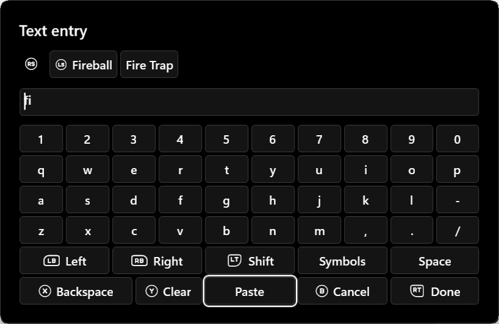

# Whole-entry text suggestions

Use optional suggestions for a gem name, app title, saved location, or recent
search. This is whole-field completion: selecting a suggestion replaces all text,
leaves the keyboard open, and does not execute an action. Done sends the existing
final-value action; Cancel sends nothing. Arrival never moves focus to a choice.

Press **LS/L3** to fill the first current suggestion without leaving the keys.
Its controller glyph appears on the first suggestion and in the controller guide
only while a result is available. Selecting any suggestion with mouse or A has
the same behavior; **RT/Done** still confirms the entry. **RS/R3** enters the
first current suggestion from anywhere on the keyboard. Left/right browses the
row and reveals overflow; R3 returns to the remembered keyboard key. Password
entry retains R3 for showing/hiding the password.

Suggestions use one horizontal row of content-sized buttons with capped label
widths. A fixed R3 glyph precedes the row; the mouse wheel also scrolls overflow.
The area collapses when idle or after accepting a result. Its top edge animates
briefly while the editor and keys stay anchored; reduced motion skips animation.
Loading, unavailable, and no-match states use compact feedback.

After text changes, previous results remain visible but inactive while the latest
query runs. L3, A and queued mouse activation cannot accept them. A response
replaces the results together; below-minimum input, an empty response, or a
deadline clears them. Editing while browsing returns focus to the remembered
keyboard key. New results never restore suggestion focus or its scroll position.
Unchanged text does not reset results or issue another lookup.



```csharp
private readonly TextSuggestionCatalog catalog = new(new[]
{
    new TextSuggestion("fireball", "Fireball", "Fireball", "Skill gem"),
    new TextSuggestion("fire-trap", "Fire Trap", "Fire Trap", "Skill gem"),
});

// In Render(), keep this key stable until the catalog or eligibility changes.
// UI.TextEntry(search, "Gem name", "search", "gem-search", 100)
//     .Suggest("gem-catalog-v1");

public override ValueTask<TextSuggestionResult> OnSuggestTextAsync(
    TextSuggestionQuery query, CancellationToken cancellationToken)
{
    if (query.FieldId != "gem-search" || query.SourceKey != "gem-catalog-v1")
        return ValueTask.FromResult(TextSuggestionResult.NotAvailable);
    return ValueTask.FromResult(catalog.Search(query, cancellationToken));
}
```

`Suggest(sourceKey, minimumLength: 1, maximumResults: 6)` opts in. Use an opaque
source key and change it when the catalog, filter, or eligibility changes. Never
change it on every render. Providers receive transient editor text, unlike ordinary
TextEntry actions, so do not persist it, log it, or invalidate the view per edit.
The callback runs independently of the serialized action lane. Capture a small
immutable index under your state lock, then search outside it. Do not invoke the
calculation engine per keystroke. Honour cancellation for asynchronous providers.

`TextSuggestionCatalog` is an optional immutable helper for up to 10,000 entries.
It sorts once, then returns case-insensitive prefix matches before substring
matches. Search the whole query; it does not split words. A provider that already
ranks matches can return its own results; the host preserves their order and does
not filter them again. No external fuzzy-matching package is required.

## Host defaults and limits

For remote or expensive providers, override just the options you need:

```csharp
UI.TextEntry(search, "Search", "search", "search-field", 100)
    .Suggest(new TextSuggestionSource("remote-catalog-v1", MinimumLength: 2)
    {
        DebounceMilliseconds = 300,
        MinimumRequestIntervalMilliseconds = 500,
        TimeoutMilliseconds = 5000,
    });
```

| Widget option | Default | Allowed range |
|---|---:|---:|
| Minimum characters before suggestions (`MinimumLength`) | 1 | 0–64 |
| Maximum results (`MaximumResults`) | 6 | 1–8 |
| Typing pause (`DebounceMilliseconds`) | 180 ms | 0–1,000 ms |
| Minimum time between request starts (`MinimumRequestIntervalMilliseconds`) | 250 ms | 250–2,000 ms |
| Provider deadline (`TimeoutMilliseconds`) | 2,000 ms | 500–5,000 ms |

`MinimumLength = 0` permits an initial empty query, useful for recent searches.
It is a threshold for starting suggestions, not the field's maximum text length.
Lengths use UTF-16 units, consistently with TextEntry's maximum length.
The host waits for both the typing pause and request interval. Zero debounce
does not remove the rate limit. Invalid settings fail declaration validation;
the host never trusts unbounded values. Changing options retires an open editor,
just like replacing its source key. Keep PoB's inexpensive local lookup on defaults.

Concurrency, stale-result protection, payload bounds, focus, and explicit Done/Cancel
are host-owned and cannot be disabled. Matching and result ordering remain provider
choices; the host does not apply a second filter or infer per-word completion.

| Setting | Host behavior |
|---|---|
| Pacing | Uses the validated field options above |
| Work | One active query and one replaceable pending text value per editor |
| Results | Six by default, at most eight; a single horizontally scrollable row |
| Text | At most 512 UTF-16 units, also bounded by the field maximum |
| Labels/descriptions | At most 96/128 UTF-16 units; no control characters |
| Provider deadline | Uses the validated field option; failure shows unavailable and Done remains usable |
| Late replies | Session, revision, source, field, scope and owner revalidated |
| Provider misuse | Invalid/duplicate/oversized output rejected; one worker callback at a time, even after timeout |

Timeout sends a terminal result promptly but keeps worker capacity reserved until
the actual callback finishes. Ignoring cancellation cannot accumulate background
callbacks. The bridge also limits concurrent queries to one per widget and eight
globally. Suggestions never start an unloaded worker. A custom worker that fails
to respond to protocol cancellation can be terminated by the existing process
boundary; provider errors alone do not terminate a healthy worker.

The latest pending display also has a bounded wait if an older callback ignores
cancellation. It becomes unavailable rather than retaining inactive choices
indefinitely. If the callback later drains, the latest pending query can proceed;
once dispatched, it receives its full configured provider deadline.

Sensitive fields, pinned fragments, indexed-item text fields and browser live-edit
keyboards do not support suggestions in this version. Ordinary widget fields do.
Per-word prediction, token/range replacement, fuzzy matching and submit-on-choice
are intentionally separate from this API. They require caret/token semantics and
different user expectations; do not emulate them by silently changing this contract.

## Design references

- [WinUI AutoSuggestBox](https://learn.microsoft.com/en-us/windows/apps/design/controls/auto-suggest-box)
  separates editing, choosing and submitting. WidgetRail keeps that separation.
- [MUI Autocomplete](https://mui.com/material-ui/react-autocomplete/)
  recommends throttling async search and avoiding duplicate filtering of server results.
- [Qt QCompleter](https://doc.qt.io/qt-6/qcompleter.html)
  exposes distinct prefix/path completion policies. Token completion should be
  explicit rather than inferred from spaces in an item name.
- [jQuery UI Autocomplete](https://api.jqueryui.com/autocomplete/)
  exposes `delay` and `minLength` to avoid unnecessary searches.
- [Avalonia AutoCompleteBox](https://docs.avaloniaui.net/docs/reference/controls/autocompletebox)
  exposes `MinimumPopulateDelay`, `MinimumPrefixLength`, and filtering choices.

These frameworks separate input thresholds, population timing and filtering.
A provider deadline is usually application/network policy; WidgetRail owns it at
the shared process boundary so widgets do not each need timeout/recovery plumbing.

Default suggestions require protocol 88 (introduced in SDK 0.4.5-dev). Custom timing
requires protocol 89 and SDK 0.4.6-dev; older hosts must reject that feature instead
of silently using a shorter deadline. Existing fields remain commit-only.

## Offline word completion

Text entries with no input kind now receive host-local English word completion
by default when they have no widget suggestion source. `Prose` explicitly requests
the same behavior. Existing packages whose field metadata omits the kind also
benefit from this default; live browser editors remain excluded.

```csharp
var message = UI.TextEntry(draft, "Your message", "message", "message.entry", 2048);
var identifier = UI.TextEntry(id, "Identifier", "identifier", "identifier.entry", 100)
    with { InputKind = TextEntryInputKind.Ordinary }; // Explicit opt-out.
```

The SDK preserves omitted metadata separately from explicit `Ordinary`, without
changing the public property type. Fluent copies preserve that distinction. Older
SDK builds serialized `Ordinary` as omitted; rebuild technical fields with the
current SDK to express the opt-out. Use `SensitiveTextEntry` for passwords and keys.

With an English UI language, two letters at the caret produce local completions.
L3 or choosing a result replaces only the current word, preserves surrounding
text and leaves the keyboard open. Moving the caret invalidates old results,
even when the prefix is unchanged. No server queries, history learning, automatic
correction or submission occur. Widget-supplied suggestions take priority and
retain whole-field replacement semantics, including when they return no matches.

`Url` and `Email` retain their specialised layouts and allow word completion,
including the browser address/search editor. Completion replaces only the alphabetic
fragment at the caret, preserving dots, slashes, `@`, underscores and other separators;
it does not infer domains, validate addresses or navigate. Live webpage editors remain excluded.
`Integer` and `Decimal` suppress word completion. Raw modifier syntax, identifiers and mixed link/file-path fields
use explicit `Ordinary`. Input purposes do not replace committed-value validation.

The bundled vocabulary contains 82,765 frequency-ordered English words from
SymSpell's Google Books/SCOWL-derived dictionary. It loads once on demand; no
SymSpell library or network access is used. At most five completions are shown.
