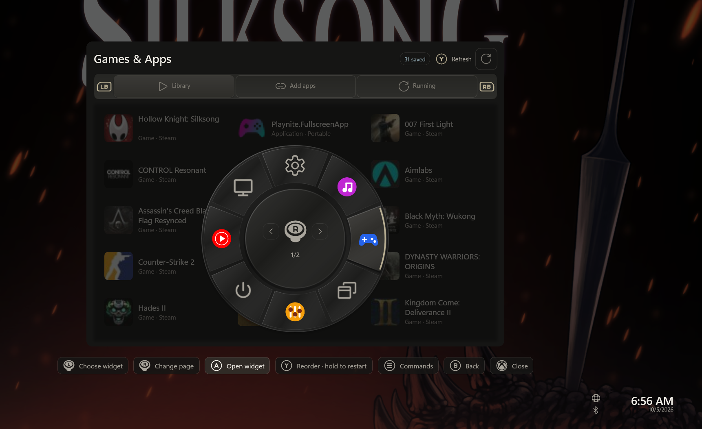

# Controls and everyday use

The controller guide at the bottom of the overlay shows actions for your
current focus. A widget can provide its own shortcuts.

| Input | Usual action |
|---|---|
| View + Menu | Show or hide the overlay; configurable to Guide in Settings |
| D-pad / left stick | Move focus |
| A | Activate the focused control |
| B | Go back; at a widget's top level, return to the tray |
| Right stick | Scroll a scrollable area |
| Menu on the tray | Open widget/pinning options |
| Y on the tray | Reorder widgets; hold to reload the selected widget |

With a keyboard, use arrows, Enter and Escape to navigate. To toggle the overlay
with F1, enable **Settings → Controllers → F1 keyboard shortcut**. This is off by
default, leaving F1 available to other applications until enabled.
Text fields can use the built-in controller keyboard.

**Stop widget** keeps a widget stopped until you start it again, including across
overlay restarts. Settings is always available and does not offer Stop widget;
its Restart widget action remains available. Old saved stop choices for Settings
are ignored. Settings still suspends when hidden.

## Controller keyboard

The D-pad and left stick wrap around the keyboard's rows and top/bottom edges.
Use A/Cross to type the selected character or activate an action.

| Input | Keyboard action |
|---|---|
| Hold A/Cross on a character or Space | Repeat that character |
| X/Square (hold to repeat) | Delete before the caret |
| LB/RB (L1/R1; hold to repeat) | Move the caret left/right |
| LT/L2 | Toggle uppercase letters |
| Y/Triangle | Clear the draft |
| RT/R2 | Submit the draft |
| B/Circle | Cancel |
| R3, for private text | Show/hide the password |

Character repeats begin after 400 ms and continue every 90 ms. After at least
four repeated character steps and one second held, deletion/caret movement can
advance by words every 250 ms. Private fields keep character steps. Moving to another key or
changing the character layer cancels a held character. Actions such as Clear,
Done, Cancel, Shift, Paste and Show/Hide never repeat.

The bottom-row **Paste** key inserts clipboard text at the caret or replaces the
selected text, without closing the keyboard. It also works in password fields,
which are masked by default, and website fields using the browser's normal paste behavior.

The caret remains visible while controller keys have focus. Private text starts
hidden whenever an editor opens. Switching from native mouse/keyboard editing
of a password back to controller editing starts the controller caret at the end;
use LB/RB to position it. Ordinary text retains its native selection.

Physical keyboard paste remains available, including Ctrl+V and Shift+Insert.
Both keyboard modes open with Q visibly focused. When a virtual key has focus,
physical Left/Right move the text caret and Enter activates the selected key.
Physical Space always types a space. Enter submits when the text editor has focus.
The keyboard sizes responsively while keeping every key and action visible without
scrolling. It can extend outside a small widget or pin.
Hiding the overlay or leaving the widget cancels an unsubmitted widget-field draft.

Browser and webapp fields work differently: point at a field and click A to open
the keyboard, including a field that already has focus. These edits reach the page
as you type. The keyboard floats beside the rendered field without shrinking the
webpage, preferring below the field and using the space above or beside it when needed.
B or Done closes the keyboard and keeps the edits; **Send Enter** is
the explicit action for sending an Enter key to the website. Existing password text
is represented only by masks. Widget fields, browser addresses and website text
prompts keep the draft/confirm behavior described above.

## Websites and notifications

Use [Browse with a controller](browsing.md) for pointer, D-pad, toolbar, live
website typing and new-window controls. [Webapps](webapps.md) explains adding
and managing your sites. [Notifications](notifications.md) covers the bell,
opening/dismissing entries and per-widget delivery choices.

## Switch widgets with the radial chooser and rail

The radial chooser and horizontal rail are both available. Older rail-only
preferences are retired without changing your other settings.

- Press B at a widget's top level to open the wheel. Nested pages and menus still
  handle Back first.
- Move down past the widget's bottom row to enter the rail. Left/right previews
  widgets and enables their dashboard shortcuts. Press A or move up to enter.
  B opens the radial chooser with the current widget selected.

The wheel opens over retained widget content without changing its layout. Point
the left stick toward a widget to preview it, then press A to enter. D-pad and
keyboard arrows move between slots. B returns to the selected preview.

Each page holds eight icons with accessible names and tooltips. The center shows
the paging controller hint. Its preferred diameter is 400 logical pixels, scaled
by display/interface settings and reduced to fit available space. Hold the right
stick left/right to change pages. Browsing pages preserves the selected widget
until you choose another icon. Release the left stick before pointing at an icon
on the new page. Menu and Y retain their tray actions.

View keeps its pinned-view focus shortcut. Inside a widget, the right stick
still scrolls; release it to neutral when moving between the wheel and a widget.
If Windows composition is unavailable, WidgetRail uses the rail as a fallback.

## Settings and system controls

Settings controls appearance, scale, themes, widget order and enablement,
permissions and controller behavior. Settings itself remains enabled.
The Quit and Restart buttons in its header affect **WidgetRail**, not Windows.

The **Power** widget controls the PC. Sleep is immediate. Restart and Shut down
ask for confirmation, with Cancel selected first.

The tray clock shows local time. Its internet indicator reflects connectivity
over Wi-Fi or Ethernet; the Bluetooth indicator reflects radio power.

## Pin a supported view

Use Menu on a tray icon to manage pinning. Pin controls also let you adjust or
remove an existing pin without finding the icon that originally created it.
A widget decides which views it supports for pinning; the full widget is not
automatically a pin option.

## Review permissions

Optional sandboxed widgets request specific permissions for Windows operations,
including packages preinstalled by Production. Review them under Settings → Widgets.
Settings and Catalogue have host-managed defaults; explicit denials are preserved.

A **full-trust application** widget is different: it runs with your ordinary
Windows user access. Only enable one from a source you trust. See
[Security and trust](../maintainers/security-and-trust.md).

*Earlier-build illustration; follow the current on-screen guide for available actions.*
