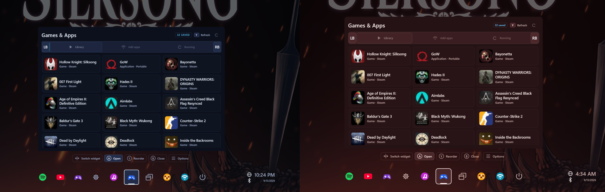

# Customization

Open Settings to adjust the overlay. Quit and Restart here
refer to **WidgetRail**, not shutting down or restarting Windows. PC power
actions live in the Power widget.

## General

Choose the overlay position and use **Start WidgetRail when I sign in** to manage
startup from an installed copy. WidgetRail starts quietly; your opening shortcut
shows the overlay. If Windows has disabled the registered entry, enable it in
**Windows Settings → Apps → Startup**. The General startup switch is restored
after preview.37; on that release, use the installer or Windows Startup Apps.

## Appearance

New installations and reset appearance settings start with Mono Ink.
Changing this default does not replace an existing saved theme selection.

Choose a theme and adjust the interface scale until text and controls are easy
to read from where you play. Shared widget controls and controller hints use
theme colors. Widgets may also supply their own artwork and style choices.

The built-in collection includes ten themes:

| Theme | Appearance |
| --- | --- |
| Mono Ink | Graphite and white with firm edges and minimal decoration |
| Velvet Dusk | Muted violet surfaces with serif headings |
| Canopy | Evergreen surfaces and pale sage accents |
| Amber Signal | Warm instrument-panel colors and amber accents |
| Mineral Light | Light mineral surfaces with dark petrol text |
| Warm Graphite | Warm graphite with parchment accents; formerly named Default |
| Cool Slate | Blue-grey surfaces with steel accents |
| Neon Circuit | Indigo surfaces, cyan accents and angular controls |
| Arcade Rush | Plum surfaces, pink accents and rounded controls |
| Redline | Oxblood surfaces, coral accents and a scarlet tray edge |

Mono Ink is a visual theme. Use the separate contrast accessibility setting
when you need the host's high-contrast policy.

**Settings → Appearance → Interface size** ranges from 50% to 125%. Lower it if
Windows display scaling makes the overlay too large. The size is saved per display.

Accessibility settings can adjust text and contrast, motion, and transparency.
Try changes in a widget you use often so you can see how they affect real content.

**Settings → Appearance → Section animation** controls tab changes inside widgets:
**Slide** (default) moves pages horizontally; **Paging** raises the next page
while the previous page recedes; **Vertical slide** moves pages up or down;
**Reveal** uncovers stationary content; **Cover slide** moves the new page over
the previous page; **None** changes pages immediately.
**Page animation** separately controls opening detail pages and going back.
**Animate widget dialogs** independently controls opening and closing motion.
**Focus animation** offers **Settle** (default), **Fade**, and **None**.
Settle expands the outline from up to 6 DIPs inside the control over 220 ms,
starting at 65% opacity. Fade changes outline opacity over 240 ms without
outline movement. These effects leave the control geometry unchanged. Existing
WRSS scale and press feedback still apply to the whole control, including its outline.
Controller hints appear immediately with Settle and Fade. Animation speed and reduced
motion apply to focus highlights; saved animation choices remain respected.

**Dialog animation** offers **Zoom** (default), which grows the dialog from 90%
to full size, and **Lift**, which slides it gently into place. Explicit saved
choices remain respected when defaults change.
**Widget animation speed** ranges from **0.5×** (slower) to **2×** (faster), with
**1×** as normal speed. It scales section, navigation-indicator, focus-outline and dialog timing
together. These preferences apply immediately and survive restarts. Reduced motion,
including the Windows preference when followed, overrides both without changing
your saved choices. Tray widget-switch animation remains in **Settings → Appearance**.

Focus normally settles in place using a thin theme-accent edge and surface emphasis.
Panels, controls and dialogs use subtle shading and shadows to show depth.
Old focus Slide preferences migrate to Fade; section Slide remains available.
High contrast retains
a stronger outline, and reduced motion disables animated focus changes.
Widget or theme authors can instead use WRSS scaling to enlarge a focused card
with its text and artwork. This uses the existing styling rules, rather than a
separate competing zoom setting.
Games and Apps cards, Settings category cards, Playnite posters, YouTube Music
Home posters, and the Spotify and YouTube Music play buttons use subtle focus
enlargement. Their layout positions stay fixed. Animation speed applies to the
effect; Reduced motion switches sizes immediately without animation.
Buttons and action surfaces compress while pressed, then return to their normal
or focused size. Context menus and dropdowns open with a short zoom toward their
trigger. Both effects follow Animation speed and Reduced motion; commands and
menu dismissal remain immediate.

## Arrange your tray

Choose **Settings → General → Position** to place the overlay in the center,
bottom left, or bottom right. Center is the default.

Corner layouts keep the outside edge and bottom edge of the widget fixed as it
resizes. The guide and rail stay in place. The open widget is the first visible
rail icon at bottom left, or the last at bottom right; your saved widget order
does not change. Guide hints align with the chosen corner and remain centered
in Center mode. B opens the radial chooser from the rail or the root of a widget;
directional navigation into the rail continues to use the rail.

Reorder widgets to keep your frequent actions close together. The tray's
controller guide shows the reorder and reload actions. You can disable widgets
you do not use. Settings stays enabled so you can manage the application.

## Manage widgets

**Settings → Widgets** is the place to review permissions, enable or disable a
widget, install packages, and manage versions. **All**, **Built-in**, and
**Widgets** filters share a virtualized scrolling list. Only Settings and Catalogue
are built-in; Production preinstalls ordinary optional packages. Back from details
returns to the selected widget and restores it into view.

- **Install:** choose a `.wrwidget` file in the Windows file picker (mouse/keyboard). The overlay shows controller-accessible full-access approval when needed and completion dialogs. Fresh installs start enabled and ask for permissions when features need them.
- **Update:** use **Catalogue → Updates** for catalogue add-ons, or **Update from file** in widget details for a local package. Updates preserve enabled/disabled and stopped state, permissions and saved data; new permissions are not granted automatically.
- **Revert:** disable the widget, open **Technical details**, and choose **Revert to previous version**. Ordinary updates keep one backup and clean older versions automatically. Use the normal update action to return to the newer version.
- **Uninstall:** remove an optional widget from its details, including one preinstalled by Production. If it is enabled, confirm **Disable and uninstall**. Its host-owned saved state, configuration and browser data are removed as part of that confirmation.
- **Clear local data:** reset the selected widget's saved state, configuration and browser data, then restart it. This includes website sign-ins, bookmarks/history and profile-specific extension settings. Downloads, externally owned provider data and separately stored integration credentials are kept.

Settings and Catalogue belong to the application release and are not separately
uninstalled or updated from a package file. Every other widget uses the same
installation, update and removal controls, regardless of its publisher or bundle.
Production seeds its initial selection once; later app updates do not reinstall a
widget you removed or overwrite its selected package version.

If an installed package duplicates a sealed built-in identity, Settings labels it
an **Unused copy** and offers **Manage built-in version**. This applies to the core
widgets, not the optional packages preinstalled by Production. Local Data controls
apply only to the copy you select.

## Permissions

Enable only the Windows capabilities you want a widget to use. A permission
describes access such as reading audio devices or switching windows. Built-in
widgets receive their declared host capabilities by default; explicit user
denials are preserved. Optional packages receive no capability grants from
installation, including Production's initial packages. Full-access approval and
capability consent are separate decisions. See
[capabilities](../reference/capabilities.md) for the exact trust boundary.

A **full-access** widget runs as an ordinary Windows application and can do more
than a sandboxed widget. Review its source and publisher before enabling it.
An integrity checksum detects changed bytes; it does not establish who wrote them.

## Controller options

D-pad and left stick normally move focus. If there are no more controls in that
direction but the container can still scroll, navigation scrolls the remaining
content. The right stick scrolls directly. The old **Hold D-pad to scroll**
preference is not exposed by the WinUI frontend.

Choose either **View + Menu** or **Guide** as the opening shortcut. Optional
Exclusive control has separate driver requirements and compatibility limits.
Changing it may require reopening other applications before the change takes effect.
See [Compatibility](known-limitations.md) before using it.

## Stop a widget without disabling it

Choose **Stop widget** at the bottom of its tray menu. This ends its background
work, playback, browser connections, additional pages and current pin. Saved
sign-ins, permissions, configuration and remembered pin size/position remain.
Other widgets keep running.

The widget stays in the rail and radial chooser. Opening it shows **Widget
stopped** with **X Reload** and a Reload button, rendered by the host without
starting the worker or browser. **Start widget** is also available in the tray
menu. Only explicit start/reload clears the stop: switching widgets, reopening
the overlay, restarting the PC, package updates and intents do not. Stopped
widgets are unavailable as intent destinations until reloaded.

Disable removes a widget from the chooser. Stop remains remembered if it is
disabled and enabled again. The single Stop widget command replaces Stop webapp
session; website controls continue to manage permissions, new-window behavior
and profile data.

*Earlier-build illustration; the current theme list and settings above are authoritative.*
