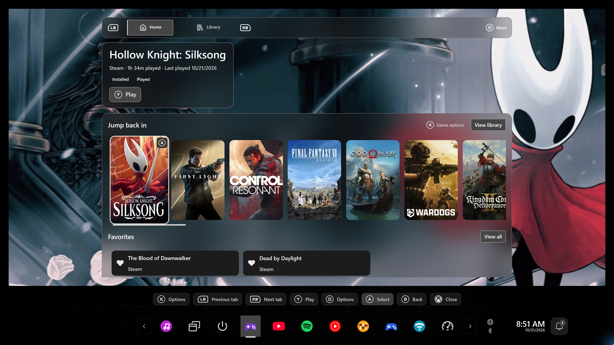
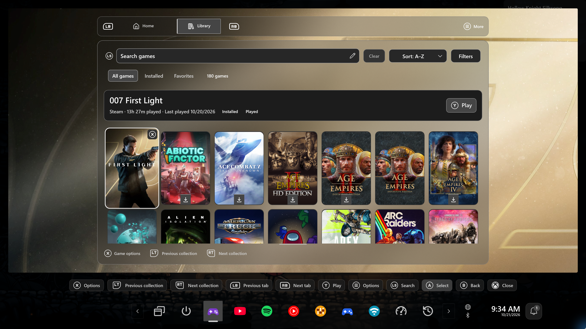

# Playnite Library

Bring your Playnite library into WidgetRail. Browse game artwork, find something
to play, and launch it with your controller without leaving the overlay.



[Screenshot context and credits](../../docs/images/widgets/README.md).

## What you can do

- Browse installed games on Home, or search your wider library in Library.
- Browse cached achievement progress and recent unlocks in the Achievements section.
- Configure PlayniteAchievements screenshots and clips from **Achievements → Capture settings**, then browse related media in each game's **Captures** tab.
- Filter by favorites, installed status, source, and collections.
- Open game details over the current page, then launch installed games through Playnite.
- Watch a muted trailer or browse Steam screenshots in Game Details. Down enters the thumbnail strip, Left and Right change the preview, and Back returns from fullscreen. Supported publisher YouTube trailers play signed out.
- Read descriptions, metadata, achievements, and play-session history in game details.
- Request installation or uninstallation through Playnite and the game's launcher.
- Choose Play to launch a game. Allow **Switch to open windows** to bring the game's verified window forward automatically. Reopening the overlay cancels a pending switch. Declining the permission still launches the game through Playnite.
- Organize favorites, hidden games, categories, and completion status.

## Discord on Currently Playing

While a game is running, the Discord card sits beside **Resume playing**. Choose **Connect Discord** to let Playnite read the friend and voice activity Discord shares. The permission is specific to Discord and can be revoked in WidgetRail Settings.

**Start Discord** starts the widget in the background. If the Discord card asks you to sign in, select Discord on the rail and sign in there. Return to Playnite to see friends and calls.

Two people fit in the compact card. A third expands it to two columns. Open the card to join a friend’s voice channel or watch and pin a stream while keeping Playnite selected. If Discord needs microphone access, the prompt appears over Playnite. B or Escape closes the panel and returns to the shelf. X on the card opens its visibility options.

## Connect your library

This widget includes **WidgetRail for Playnite**, an independent Playnite plugin
with a local-only API. Guided setup installs and connects it without a separate
download or copying a token. Existing Playnite Bridge installations can stay:
the two plugins have separate identities, servers and credentials.

1. Install Playnite Library from **Catalogue**, or its published `.wrwidget` through **Settings → Widgets**. Review the full-access prompt. A fresh interactive install starts enabled; an update preserves the existing enabled state.
2. Install [Playnite](https://playnite.link/) if you do not already have it.
3. Open the widget and choose **Set up connection**. Setup detects Playnite and its data profile; choose a profile if more than one is found.
4. Select the displayed connection action. When installation or repair is needed, the button explains that Playnite will restart. Setup preserves its library and integration preferences, connects, and returns to your library.

If a running Playnite copy needs the integration or a new connection, the widget opens setup
for that profile automatically, showing its data folder before any change. Other
stopped installations are preserved. If selection is ambiguous, choose a profile in
connection settings.

If Playnite is stopped later, opening the widget shows a **Playnite isn't running**
dialog with **Start Playnite** already focused. If the integration is missing,
the dialog offers **Install integration and start Playnite** instead. The check
also runs when entering the widget from its tray preview. B dismisses it to a recovery screen;
the launch action can be reopened there. Starting Playnite keeps focus on the busy
button and reports connection failures in the same dialog. It starts
Playnite with the selected data profile and normal library-update settings, suppresses
the splash screen, and requests a tray start. Playnite can still briefly show its
main window and take focus; its fullscreen startup preference is also respected.
The progress panel shows the current step and keeps the launch button focused.
Setup continues if the overlay hides. Reopen WidgetRail to see its result.

Launch uses the existing Windows desktop shell so Playnite keeps running when
the widget stops or WidgetRail exits. No File Explorer window needs to be open.
If the desktop shell is unavailable, start Playnite manually and retry; the
widget does not fall back to a process that would close with it.

Healthy current WidgetRail integrations are reused; recognized older builds get
an update offer. Unknown/newer builds remain under your control. **Advanced**
provides custom application/data folders and manual token controls. Keep Playnite
running while using the widget.

The plugin selects an available loopback port and tells the widget where to connect.
It never uses the original Bridge's port 19821. Credentials are scoped to the selected
profile in Windows Credential Manager. Reopen **Menu → Playnite connection** to reconnect.

If setup cannot finish, it reports the next step and restores its previous
integration/settings when possible. Finish any Playnite startup or shutdown dialog
and retry. Interrupted updates retain a recovery record and one backup outside
Playnite's extension discovery folders. Setup never force-terminates Playnite.

## Use it with a controller

| Control | Action |
| --- | --- |
| A | Open Game Details from a poster, or switch directly to the running game from **Resume playing** |
| LB / RB | Switch Home and Library, or details tabs while a game is open |
| L3 / left-stick click | Jump to search in Library or Achievements |
| Right stick movement | Scroll the focused list or panel |
| Y | Play or install the focused game. On the game's Achievements tab, sync that game when supported |
| X | Open the focused game’s quick actions |
| Menu | Page options: Settings, Categories, Hidden games, and Playnite connection |
| B | Close details or a nested page; from Home/Library, return to the tray |

Use the **Home** and **Library** navigation tabs to switch between peer destinations.
Each keeps its own game focus, filters, and scroll position. Home retains the last
focused game summary and artwork while using the tray, other controls, or details;
it falls back if that game leaves the current view, including query replacement. Home shows installed
games; Library includes uninstalled games too. Selecting either destination enters
its game list. Game details appears inside the widget with the page dimmed behind
it; B restores the selected game. Switching detail tabs preserves your position. The poster and primary
controls share the top row, with Play/Install and a favorite icon beside the poster and full-width
details tabs below. The tabs stay visible while their content scrolls. X opens game options including category membership and Uninstall. Failed sections offer **Try again** in place.
Long details scroll inside the panel. Hiding and reopening the overlay preserves
the open details, tab, focus, and scroll position while the widget remains loaded.
Interrupted reads resume; installation requests are never replayed automatically.
Source and the current completion status appear together beside the poster; the
Completion dropdown below Play lists Playnite's statuses, including custom ones, with the
current value selected. Choose a status to apply it; the confirmed value updates
without reloading the dialog. Descriptions preserve paragraphs and bullet lists.
B dismisses details explicitly. After the five-minute unload or an application
restart, the widget returns to its ordinary page.

Home prioritizes recently played installed games and shows up to three favorites, with a View all action. Library keeps a fixed summary above its cover grid. Game names remain in the summary and missing-artwork fallback, without extra captions below covers.

Search suggests titles from the cached library without making provider requests while typing. All games, Installed and Favorites are quick filters; **Filters** holds Source, Category and Recently played. Changes in that panel take effect together on Apply; B cancels.

The **Installed** filter narrows Library. Game details offers **Install** for uninstalled
games and **Game options → Uninstall** for installed games, with confirmation before requesting
uninstallation. Follow any Playnite or launcher prompts, then refresh to see the result.
Achievement tracking uses a separate passive pin; game details remain in the widget.

**Achievements** reads [PlayniteAchievements](https://github.com/justin-delano/PlayniteAchievements)
first, with [SuccessStory](https://github.com/Lacro59/playnite-successstory-plugin) as a fallback,
and **Activity** requires [GameActivity](https://github.com/Lacro59/playnite-gameactivity-plugin)
in Playnite, with saved data for the selected game. Missing data is explained in the
relevant tab. Achievements scroll continuously, with local search, All/Locked/Unlocked
filters, and sorting by recent unlocks, rarity, name or numerical progress when available.
Each row shows its description, icon, status, rarity, unlock date and available progress
directly. Press **X** or right-click a visible unfinished achievement with a unique provider ID to track it, including achievements without a numerical counter. **Track achievement** remembers one choice per game in the connected Playnite profile. **Stop tracking** clears that game's choice. Achievements with measurable progress also offer **Pin progress**, which can follow a different achievement. Currently Playing features the tracked choice, the latest unlock, and one **Next activity** suggestion by default. Suggestions start with the highest known player unlock percentage among visible locked achievements. In **Playnite settings → Currently Playing cards**, set **Next activity cards** to **Off** or choose a limit from 1 to 5. Selecting an achievement opens its full row in Game Details. Press **A** on a secret achievement to reveal its
description and artwork. Search suggestions use all loaded, revealed achievement names;
the active filter still controls results. Sessions groups virtualized history by date. Press **A** on a session with highlights to browse all its matched unlocks and captures, and **B** to collapse it. Data loads when you open the
tab and updates when Playnite reports changes. **Sync this game** or **Y** on the
Achievements tab asks PlayniteAchievements to sync that game when supported. Playnite
owns provider accounts and prompts. Closing the view does not cancel an accepted sync.

Track one achievement in a compact passive progress pin. Selecting another eligible achievement replaces its content while preserving the window position, size and opacity;
**Adjust progress pin** and **Unpin progress** are in the Achievements tab. Missing
or filtered data becomes unavailable, never another achievement. Hidden locked
achievements, completed achievements, and achievements without numeric progress cannot be pinned. Progress updates when PlayniteAchievements refreshes its data. Unlock notifications remain owned by PlayniteAchievements; this widget does not send duplicate banners.

The interface follows your selected WidgetRail theme. Categories open by selecting
the row; game covers retain their original artwork colors.



[Game details and achievements](../../docs/users/widget-gallery.md#playnite-library).

## Common questions

**The widget asks me to set up the connection.** It may have found a stopped
Playnite profile, missing integration, or credentials that do not match that
profile. Open **Set up connection**, check the displayed profile and use the
offered action. A stopped portable installation that has never been detected
needs to be started once or selected under Advanced.

**The saved token was rejected.** Open **Menu → Playnite connection** and check
that the intended Playnite profile is selected. Guided setup can save its current
token. **Advanced** also provides manual token entry and **Test connection**.

**The integration is unavailable.** Start Playnite, then use **Playnite connection → Test connection**. Guided setup can offer an update or reconnect the selected profile.

**A game is missing.** Home only shows installed games. Check Library, clear its
filters, and refresh after changing your library in Playnite.

**Does closing the overlay close Playnite?** No. The widget unloads after five
minutes hidden to release memory; Playnite and its integration keep running.

## Verify, reconnect and remove the connection

After setup, confirm that Home/Library shows your games. Use **Playnite connection
→ Advanced → Test connection** to check API access. A game list does not prove
that optional achievement/activity plugins have data; open a game's tab to check
those separately. Achievements read Playnite's locally synced data, not a new
provider sync.

To reconnect, reopen **Menu → Playnite connection**. Check the displayed program
and data profile before choosing the offered install/start/repair action. The
widget never force-kills Playnite. Setup can briefly show Playnite or take focus;
reopen WidgetRail to see the result.

Use **Advanced → Remove saved token** to delete WidgetRail's connection token from
Windows Credential Manager. This does not revoke the token inside the Playnite plugin, remove
the plugin or stop Playnite. Disabling the widget keeps its settings/credentials;
uninstalling removes host-owned widget state and browser data but does not remove
Playnite, its plugins or library, or that separately stored credential. Remove the
saved token before uninstalling if you want it cleared.

Setup changes only the WidgetRail plugin. It does not reconfigure or uninstall an
existing Bridge, add firewall rules or permit remote connections. To remove the
new integration, disable or uninstall **WidgetRail for Playnite** in Playnite's
Add-ons settings. Original Bridge clients continue to work. See the
[setup decision matrix](SETUP-DECISIONS.md) for maintainers.

## Build or customize

From the repository root:

```powershell
pwsh -NoProfile -File .\samples\PlayniteLibraryWidget\Build-CommunityPackage.ps1 -Configuration Release
```

The package is written to `artifacts/community-addons/playnite-library/` without installing it.
See [development notes](DEVELOPMENT.md) for the local API contract, state ownership, caching, and package structure.


## Achievements

The **Achievements** destination uses PlayniteAchievements' visible cached data.
It shows unlocked totals, completed games, recent unlocks, and game progress.
Search games, filter by progress, or sort by recent unlock, completion or name.
Select a game to open its existing achievement details; closing details returns
to the selected game when it is still available. LB/RB cycle the three destinations;
L3 focuses search. Narrow layouts use a compact summary and one game column.

If the provider is missing, choose **Install Playnite Achievements** in Achievements or **Install GameActivity** in a game's Sessions tab. Playnite opens the matching catalogue installer and asks for approval. An already installed provider can be enabled in Playnite's Add-ons menu. The page also distinguishes an unsupported add-on API and an
outdated WidgetRail integration. Home and Library remain available.

After installing Playnite Achievements, open the add-on in Playnite, set up and
sign in to your achievement sources, and start a refresh there. Start any
library-wide refresh from Playnite. The widget reads the add-on's cache and
updates the overview automatically as Playnite reports changes.

Only unfinished achievements with measurable progress can be tracked in a pin.
The pin uses that achievement's artwork when available. Choosing another target
updates the existing progress pin, retaining its position and opacity.

## Achievement captures

Capture settings use PlayniteAchievements' own recorder, including its clean,
notification and framed variants. WidgetRail does not start a second recorder.
Recording duration is pre-roll; the provider determines the clip end from its
notification lifecycle. Close Playnite's settings window before editing here.

Choose a screenshot or clip folder through the host picker to configure and link
it. Folder choices and disconnects apply immediately; **Save changes** applies
format and audio options. Linked folders remain visible in this dialog so older
locations can be disconnected without deleting their originals. A folder already
linked by another widget must be disconnected there before linking it here.

The host indexes linked originals without copying them, even after this widget
unloads. WidgetRail for Playnite maintains small hidden `.widgetrail-context.json`
companions for unambiguous game/achievement matches. It does not modify original
media attributes. Manually unhiding a companion remains respected. Ambiguous,
renamed or unrecognized files still appear in Capture Library without a guessed
association. Imported file modification time is not claimed as capture time.

Use **Captures** in game details, or **View captures** from an unlocked
achievement's context menu. The capture library can return to the related game or
achievement only when its matching local profile and item remain available.
Missing PlayniteAchievements disables provider setup; Home, Library and existing
linked captures remain usable.
