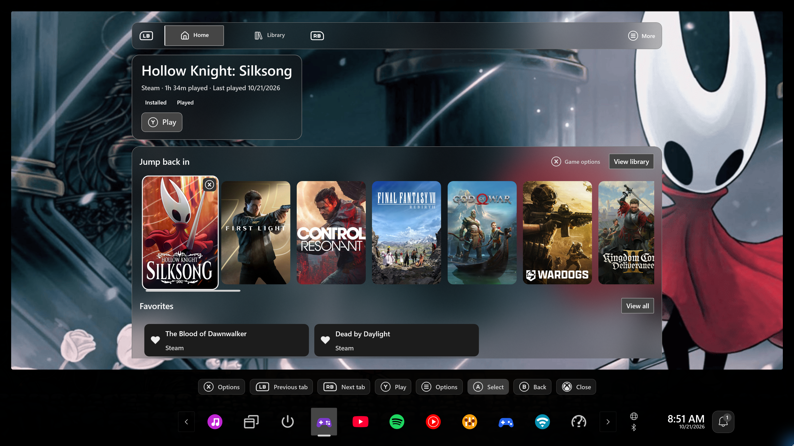
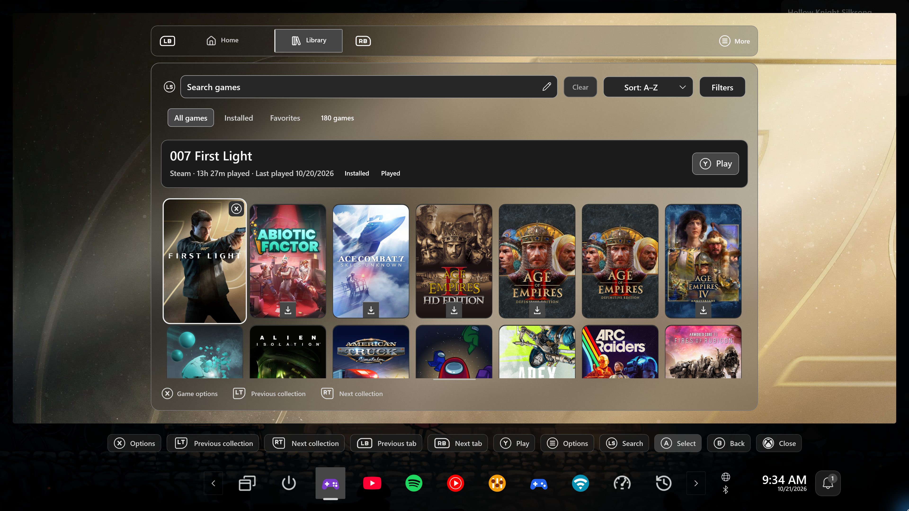

# Playnite Library

Bring your Playnite library into WidgetRail. Browse game artwork, find something
to play, and launch it with your controller without leaving the overlay.



[Screenshot context and credits](../../docs/images/widgets/README.md).

## What you can do

- Browse installed games on Home, or search your wider library in Library.
- Filter by favorites, installed status, source, and collections.
- Open game details over the current page, then launch installed games through Playnite Bridge.
- Read descriptions, metadata, achievements, and play-session history in game details.
- Request installation or uninstallation through Playnite and the game's launcher.
- Organize favorites, hidden games, categories, and completion status.

## Connect your library

This widget connects to [**Playnite Bridge**](https://github.com/rollacode/playnite-bridge)
by [rollacode](https://github.com/rollacode), a Playnite plugin that provides a
local API. Guided setup includes a tested integration package and connects it
without requiring you to download a plugin or copy a token.

1. Install Playnite Library from **Catalogue**, or its published `.wrwidget` through **Settings → Widgets**. Review the full-access prompt. A fresh interactive install starts enabled; an update preserves the existing enabled state.
2. Install [Playnite](https://playnite.link/) if you do not already have it.
3. Open the widget and choose **Set up connection**. Setup detects Playnite and its data profile; choose a profile if more than one is found.
4. Select the displayed connection action. When installation or repair is needed, the button explains that Playnite will restart. Setup preserves its library and integration preferences, connects, and returns to your library.

If a running Playnite copy needs Bridge or a new connection, the widget opens setup
for that profile automatically, showing its data folder before any change. Other
stopped installations are preserved. If selection is ambiguous, choose a profile in
connection settings.

If Playnite is stopped later, opening the widget shows a **Playnite isn't running**
dialog with **Start Playnite** already focused. If the integration is missing,
the dialog offers **Install integration and start Playnite** instead. The check
also runs when entering the widget from its tray preview. B dismisses it to a recovery screen;
the launch action can be reopened there. Starting Playnite keeps focus on the busy
button and reports connection failures in the same dialog. It starts
Playnite with the selected data profile and normal library-update settings, suppresses
the splash screen, and requests a tray start. Playnite can still briefly show its
main window and take focus; its fullscreen startup preference is also respected.
The progress panel shows the current step and keeps the launch button focused.
Setup continues if the overlay hides. Reopen WidgetRail to see its result.

Launch uses the existing Windows desktop shell so Playnite keeps running when
the widget stops or WidgetRail exits. No File Explorer window needs to be open.
If the desktop shell is unavailable, start Playnite manually and retry; the
widget does not fall back to a process that would close with it.

Healthy existing Bridge builds are reused. Setup only replaces the specifically
recognized older build; unfamiliar or newer integrations remain under your control.
**Advanced** provides custom application/data folders and manual token controls.
Keep Playnite running while using the widget.

The bundled integration is a clearly labeled WidgetRail build of Bridge 1.5.3,
with the framework-reference compatibility fix submitted as
[upstream PR #6](https://github.com/rollacode/playnite-bridge/pull/6). It retains
Bridge's extension identity and MIT license. A future compatible official release
can replace it. The package is included with the widget, so setup does not download
from GitHub.

WidgetRail uses the plugin's local API. The optional Playnite Bridge sync backend
is not required.

The supported bridge listens on `localhost:19821` and must provide the compatible
games API. Tokens are stored privately in Windows Credential Manager.
You can reopen connection settings through **Menu → Playnite connection**.

If setup cannot finish, it reports the next step and restores its previous
integration/settings when possible. Finish any Playnite startup or shutdown dialog
and retry. Interrupted updates retain a recovery record and one backup outside
Playnite's extension discovery folders. Setup never force-terminates Playnite.

## Use it with a controller

| Control | Action |
| --- | --- |
| A | Open game details; choose Play inside details to launch |
| LB / RB | Switch Home and Library, or details tabs while a game is open |
| L3 / left-stick click | Jump to search in Library or Achievements |
| Right stick movement | Scroll the focused list or panel |
| Y | Play/install the focused game; refresh while inside details |
| X | Open the focused game’s quick actions |
| Menu | Page options: Refresh, Categories, Hidden games, and Playnite connection |
| B | Close details or a nested page; from Home/Library, return to the tray |

Use the **Home** and **Library** navigation tabs to switch between peer destinations.
Each keeps its own game focus, filters, and scroll position. Home retains the last
focused game summary and artwork while using the tray, other controls, or details;
it falls back if that game leaves the current view, including query replacement. Home shows installed
games; Library includes uninstalled games too. Selecting either destination enters
its game list. Game details appears inside the widget with the page dimmed behind
it; B restores the selected game. Each opening starts at Play/Install, while
refreshing or switching detail tabs preserves your position. The poster and primary
controls share the top row, with Play/Install and a favorite icon beside the poster and full-width
details tabs below. The tabs stay visible while their content scrolls. Header hints show X Game options, Y Refresh, and B Close; X
offers game options including category membership, Refresh and Uninstall.
Long details scroll inside the panel. Hiding and reopening the overlay preserves
the open details, tab, focus, and scroll position while the widget remains loaded.
Interrupted reads resume; installation requests are never replayed automatically.
Source and the current completion status appear together beside the poster; the
Completion dropdown below Play lists Playnite's statuses, including custom ones, with the
current value selected. Choose a status to apply it; the confirmed value updates
without reloading the dialog. Descriptions preserve paragraphs and bullet lists.
B dismisses details explicitly. After the five-minute unload or an application
restart, the widget returns to its ordinary page.

Home prioritizes recently played installed games and shows up to three favorites, with a View all action. Library keeps a fixed summary above its cover grid. Game names remain in the summary and missing-artwork fallback, without extra captions below covers.

Search suggests titles from the cached library without making provider requests while typing. All games, Installed and Favorites are quick filters; **Filters** holds Source, Category and Recently played. Changes in that panel take effect together on Apply; B cancels.

The **Installed** filter narrows Library. Game details offers **Install** for uninstalled
games and **Game options → Uninstall** for installed games, with confirmation before requesting
uninstallation. Follow any Playnite or launcher prompts, then refresh to see the result.
Pinned views keep showing the page without its modal.

**Achievements** reads [PlayniteAchievements](https://github.com/justin-delano/PlayniteAchievements)
first, with [SuccessStory](https://github.com/Lacro59/playnite-successstory-plugin) as a fallback,
and **Activity** requires [GameActivity](https://github.com/Lacro59/playnite-gameactivity-plugin)
in Playnite, with saved data for the selected game. Missing data is explained in the
relevant tab. Achievements scroll continuously, with local search, All/Locked/Unlocked
filters, and sorting by recent unlocks, rarity, name or numerical progress when available.
Each row shows its description, icon, status, rarity, unlock date and available progress
directly. Ordinary rows are read-only. Press **A** on a secret achievement to reveal its
description and artwork. Search suggestions use all loaded, revealed achievement names;
the active filter still controls results. Activity retains 20 entries per page. Data loads when you open the
tab and is reused while that game's details remain open. **Refresh** reads the latest
locally synced data; it does not ask Steam or another service to sync achievements.

The interface follows your selected WidgetRail theme. Categories open by selecting
the row; game covers retain their original artwork colors.



[Game details and achievements](../../docs/users/widget-gallery.md#playnite-library).

## Common questions

**The widget asks me to set up the connection.** It may have found a stopped
Playnite profile, missing integration, or credentials that do not match that
profile. Open **Set up connection**, check the displayed profile and use the
offered action. A stopped portable installation that has never been detected
needs to be started once or selected under Advanced.

**The saved token was rejected.** Open **Menu → Playnite connection** and check
that the intended Playnite profile is selected. Guided setup can save its current
token. **Advanced** also provides manual token entry and **Test connection**.

**The bridge is unavailable.** Start Playnite and its bridge, then open
**Playnite connection → Test connection**. An incompatible bridge API needs a compatible bridge version.

**A game is missing.** Home only shows installed games. Check Library, clear its
filters, and refresh after changing your library in Playnite.

**Does closing the overlay close Playnite?** No. The widget unloads after five
minutes hidden to release memory; Playnite and its bridge keep running.

## Verify, reconnect and remove the connection

After setup, confirm that Home/Library shows your games. Use **Playnite connection
→ Advanced → Test connection** to check API access. A game list does not prove
that optional achievement/activity plugins have data; open a game's tab to check
those separately. Achievements read Playnite's locally synced data, not a new
provider sync.

To reconnect, reopen **Menu → Playnite connection**. Check the displayed program
and data profile before choosing the offered install/start/repair action. The
widget never force-kills Playnite. Setup can briefly show Playnite or take focus;
reopen WidgetRail to see the result.

Use **Advanced → Remove saved token** to delete WidgetRail's connection token from
Windows Credential Manager. This does not revoke the token inside Bridge, remove
the plugin or stop Playnite. Disabling the widget keeps its settings/credentials;
uninstalling removes host-owned widget state and browser data but does not remove
Playnite, Bridge, its library, or that separately stored credential. Remove the
saved token before uninstalling if you want it cleared.

Bridge setup preserves existing preferences, authentication and network setup.
Suppressing its optional network prompt does not add/remove firewall rules or
HTTP reservations, or turn off an existing LAN configuration. WidgetRail itself
connects through localhost. See the [setup decision matrix](SETUP-DECISIONS.md)
for maintainers' exact discovery and replacement rules.

## Build or customize

From the repository root:

```powershell
pwsh -NoProfile -File .\samples\PlayniteLibraryWidget\Build-CommunityPackage.ps1 -Configuration Release
```

The package is written to `artifacts/community-addons/playnite-library/` without installing it.
See [development notes](DEVELOPMENT.md) for the bridge contract, state ownership, caching, and package structure.
