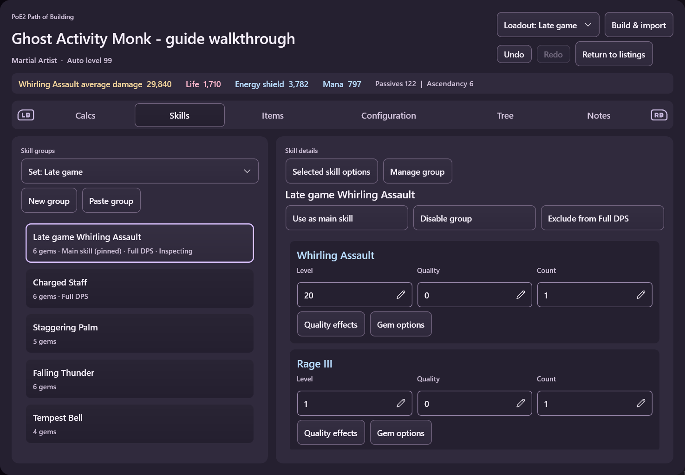
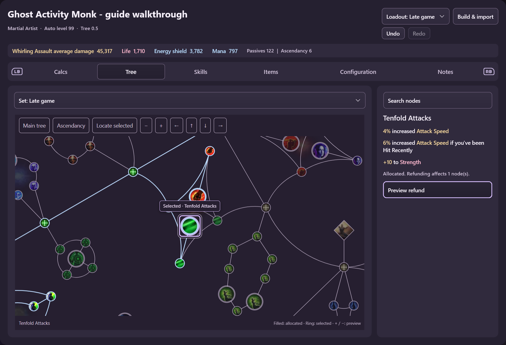
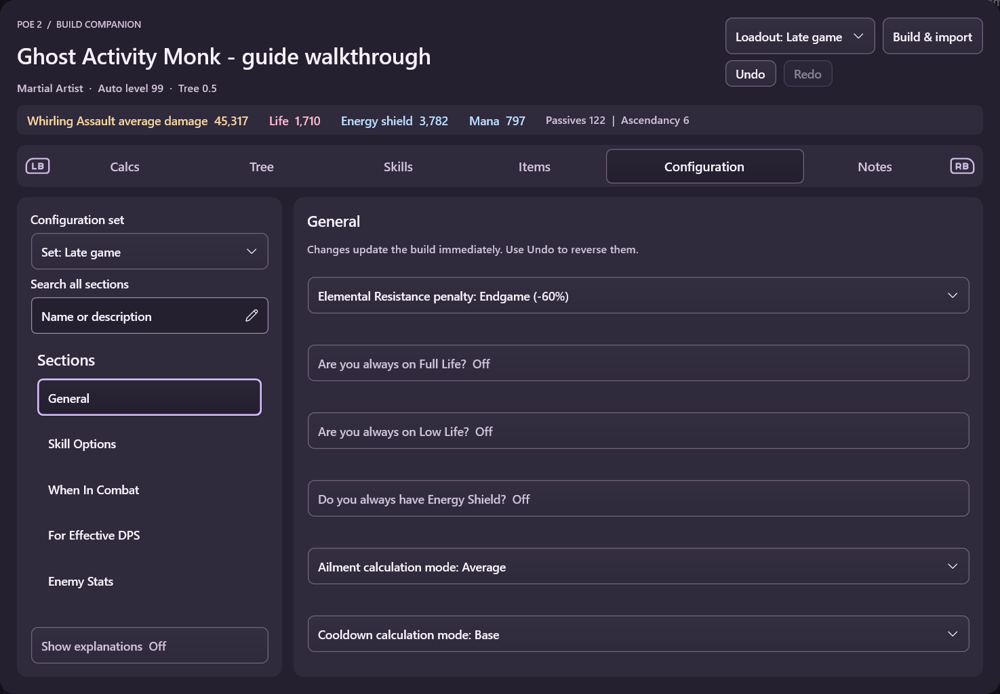

# PoE1 / PoE2 Path of Building

Two controller-first widgets share one implementation and run pinned Path of Building Community calculation engines. PoE 1 and PoE 2 remain separate because their build formats and game data differ. Calculation rules remain upstream; the adapter translates editor actions and presentation.

## Screenshots

Native WidgetRail captures in Velvet Dusk, using midgame and late-game setups from [Ghost Activity's Martial Artist guide](https://pobb.in/ttCJAV3WX9bn). These are workflow examples, not current-league build recommendations. The PNG files in [screenshots](screenshots/) are also available for the marketplace listing.

## Using a build

Paste a PoB share code or supported public build link, or enter the path to an exported XML file. The widget keeps the original import and a separate working copy. It reopens the selected working copy after restart.

Standard PoB codes copied from poe.ninja or pob.cool use the same import path and require no site-specific sign-in or integration. Direct downloads support pobb.in share links. For poe.ninja, open the website, copy the build's PoB code, and choose **Paste build from clipboard**. Direct poe.ninja URLs are rejected before any network request: its [API documentation](https://poe.ninja/docs/api) reserves character and PoB endpoints for internal use. Choose the widget for the build's game. Older codes can be migrated by newer engines, but reverse compatibility is not guaranteed. A beta export may contain fields an older engine does not understand, and different engine versions can calculate different totals. Import validation preserves authored gems, including supports attached to item-granted skills, while allowing upstream to merge duplicate generated base-skill groups.

## PoE 2 beta feature audit

The PoE 2 package is pinned to upstream's **2026-10-16 beta**, manifest version `0.23.1-bb52d6b36`, commit `84a11f1295f67a25f434329197444438514983f1`. This is the upstream `beta` branch snapshot, not a new stable release. The engine includes the 0.5.5 data update; `Tree 0.5` names the tree family rather than a patch or engine release. Build & import shows the running engine version.

| Beta change | Companion handling |
| --- | --- |
| Game data, new uniques/runes, conversion, critical chance, mana cost, support-level and other calculation fixes | Inherited from the pinned engine; calculations are not reimplemented. |
| Per-skill weapon sets | Manage group exposes both sets and upstream restrictions for weapon-granted and Spirit-reserving skills. At least one set must remain enabled. |
| Grouped custom modifiers | Configuration → Custom modifiers supports group creation, renaming, enabling, deletion, clipboard replacement, and individual line editing. Unsupported lines remain visible. Long lists are virtualized. Edits use the normal durable Undo/Redo history. |
| Configuration comparisons | X on a boolean setting previews its toggle effect. Custom modifier groups also offer Compare toggle. These read-only comparisons do not save a change. |
| Martial Artist character rune slots | Items exposes the additional slots when Runic Meridians grants them. Searchable selectors use upstream eligibility and callbacks. |
| Item modifier toggles, new unique variants and jewel catalysts | Item settings exposes applicable upstream controls and individual modifier switches. Rune/variant choices use a searchable virtualized picker; X shows full rune details. Edits affect the underlying item shared by any sets that equip it, and support Undo/Redo. |
| Lazy gem ranking | The gem picker can rank by the upstream statistic choices, including Full DPS. Name sorting remains immediate; comparison sorting runs on demand with Cancel. Rankings follow PoB's support-first order and identify the main calculation skill. |
| Gem quality explanations | Quality effects opens the selected gem's upstream tooltip, preserving its descriptions and reference-quality labels. |
| Per-node author notes | Allocated nodes expose a saved note field. Notes survive XML export/import and normal idle unloading. |
| Named weapon-set point warnings and sidebar breakdowns | Existing warning and calculation-inspector projections receive the updated upstream content. |
| Build-list class filtering | Saved builds can filter by class and search class/ascendancy metadata as well as names. The managed library is flat, so recursive desktop folders do not apply. |
| Item filtering by loadout | Equipped items follow the chosen item set. Inventory lists unequipped items and identifies their use across sets. Desktop stash integration remains outside the widget. |
| Tree texture offsets | Artwork generation handles both legacy DDS array layers and cropped DDS coordinates. |

The workflows described below extend this beta audit with set management, item drafting, gem and passive choices, trade handoff and PoE2 game-file export. OAuth/account integration remains deferred. These additions are not a claim of complete desktop parity.

The beta also changes headless startup and class constructors. Its `copyTableSafe` can write into the original object while copying new parent proxies, causing repeated attribute-node restoration to consume gigabytes. `Engine/beta-compatibility.lua` provides a narrowly scoped deep-copy correction for the new constructor API: copy raw fields first, preserve class identity, and reconnect cloned parent proxies. Upstream source files and calculation modules remain unchanged. `Tests/BetaCopyRegression.lua` verifies source isolation and proxy ownership; reconsider this compatibility helper when upgrading the engine pin.

For engines with linked loadouts, **Build & import → Save current setup as a new loadout** creates independent tree, item, skill and configuration sets. Existing loadouts remain accessible even when they previously shared a single set. Switching sets retains the main skill by its identity when there is one unambiguous match; otherwise it selects the first group instead of retaining an unrelated row number.

Damage labels follow PoB's display mode: skills that report average damage are labelled accordingly, with hit damage per second shown separately in Calcs. Item replacement offers slots accepted by the engine for the pasted item. Configuration omits inapplicable default controls while retaining authored non-default settings.

Imports default to **New build**. In Build & import, choose **Replace current build** to refresh the open build from a file, link or share code. The replacement is validated before confirmation, retains the build's name and identity, and participates in Undo/Redo across restarts. Finish any pasted item draft first. Account sign-in is not included: it requires an authorized GGG application registration for WidgetRail, separate from the upstream desktop client's identity.

The welcome screen and Build & import have a separate row for **Open pob.cool** and **Open poe.ninja**. Both follow the shared website-opening preference, which defaults to Windows' browser. Import your character on pob.cool or find a build on poe.ninja, copy its PoB export code, then return to WidgetRail and choose **Paste build from clipboard**. WidgetRail does not automate either site, inspect its login, or monitor the clipboard; clipboard text is read only when you select Paste.

- **Calcs** groups statistics beside their calculation setup. Detailed calculations follow the main skill by default; the inspection selectors can choose another group, an active skill within that group, buff mode, and player/minion where supported. These inspection choices do not change the main skill or rewrite the build’s saved desktop Calcs settings. Formula text is directly scrollable; source-table rows remain expandable when their summary is condensed. Breakdowns and source attribution come from upstream; the widget does not maintain passive-effect rules or infer causes that upstream does not attach to a calculation. Main-skill DPS identifies the skill; disabled skills show an unavailable value and PoB's reason. Full DPS identifies its included groups and contributors. Breakdowns identify their skill and calculation mode where relevant, and explain when their total differs from the overview. Matching defensive totals omit unrelated skill context. Exact repeated resource-calculation sequences from upstream are collapsed without changing their values or source rows.
- **Tree** shows upstream passive-tree positions, rendered connections and node artwork, with an adjacent node inspector. Hover or dwell with the controller pointer for modifiers and point costs. Search selection frames the node; Main tree and Ascendancy frame their respective areas. L2/R2 use the same internal map zoom as the minus/plus buttons, keeping the toolbar and surrounding layout at their normal size.
- **Skills** and **Items** keep the list beside the selected entry. Skills offers New group, Paste group and Manage group: name, equipment slot, duplicate, move and delete; add, replace, enable and remove gems through a searchable virtualized catalog. Gem creation uses upstream editor defaults. Skill options inspect and edit that group without changing the main calculation group. Item comparisons name the replaced and proposed items and show changed statistics before Apply. Descriptions preserve upstream inline formatting through native rich text and theme colors.
- **Configuration** retains upstream section names and order in a category list. Controls scroll within each section; search covers all sections, and Show explanations reveals the upstream help. Retained settings that are currently inapplicable are identified explicitly. Changes recalculate and save immediately; Undo reverses them.
- **Notes** displays a continuous scrolling document. Link buttons use authored Markdown titles when available, otherwise the destination. Recognized YouTube videos open through the video widget intent with their timestamp; unavailable or rejected video requests fall back to the original web link. Other links use the web intent. Press **L3** from the document to focus the **Notes navigation tab** without moving the document's scroll position.

Configuration, main-skill selection, skill toggles/options, gem edits and character level recalculate and save directly, without confirmation. Undo and Redo are available in the header and preserve the current section. Switching active sets also saves directly and participates in the same history. A new edit clears Redo. Each saved build retains its own history of up to twelve changes across unloading and restart; a new or imported build starts with an empty history.

Group and gem management also saves immediately and participates in the same Undo/Redo history. Removing a group or gem asks for confirmation. Reordering preserves the actual main calculation group. Automatically granted skills identify their source and equipment slot; their level is read-only because PoB regenerates it from that source. Manage group exposes their upstream Group count separately from per-gem counts. Such groups cannot be duplicated, deleted, reassigned to another item, or have gems added/replaced/removed. Remove the granting item or passive instead. Existing ordinary gems remain editable; unsupported levels are reported instead of silently clamped.

Copy group and Paste skill group use desktop PoB's clipboard format and parser. If that parser cannot recognize every pasted gem, the paste is rejected without saving a partial group. Delete all editable groups affects the current skill set and keeps automatically granted groups. These operations also participate in Undo/Redo.

The core group workflows above follow desktop PoB. Independent skill sets can be created, copied, renamed and deleted. Applicable gem options expose upstream stages, active mines, corruption and global-effect controls; availability depends on the game and selected gem. This is not a claim of complete Skills-tab parity.

Node allocation/refunds, equipment replacements and structural class/ascendancy changes retain a comparison preview. Previews are saved automatically as pending work, without applying them. **Apply** commits the proposal; **Discard** restores the previous calculations without consuming Undo or Redo history. Both decisions persist. Refund previews include dependent nodes. Pasted items awaiting a slot also survive unloading; **Discard item draft** explicitly removes them. Export uses the upstream engine's XML format and standard compressed share-code encoding. Unlike desktop PoB's separate Save action, the companion continues to save its working copy automatically.

Tree preview actions stay above the scrolling comparison panel. Right from a skill or item row enters its details; Left returns to the selected row. Section switches explicitly focus the destination content and use the host's section transitions. Animation follows the user's motion preference. Startup shows a loading indicator while the calculation engine prepares the saved build.

Long lists offer contextual **L3** jumps to their surrounding controls and back to the remembered row: passive search, saved-build search/sort, set selectors, gem-group actions and expanded tree-preview actions. Configuration cycles through search/set controls, Show explanations and the section list. Ordinary lists qualify above eight rows; taller gem cards count as two visual rows. Short lists, absent set selectors and ordinary reading content do not add shortcuts, except for Notes' explicit jump to its navigation tab. These jumps preserve the list viewport, and the tree WebView keeps its own L3 toolbar action.

**R3** jumps to the build controls (Loadout, Build & import, Undo/Redo); from those controls it returns to the remembered content control without moving the list viewport. It is unavailable during operations, pending comparisons and modal choices. Keyboards and browser dialogs retain exclusive input. Every section, including Calcs, uses the compact statistics summary above navigation.

An empty passive search lists **allocated and granted passives**. Entering text searches all interactive nodes in the current tree by name or modifier, including unallocated nodes. The result heading identifies which list is shown.

Comparison previews use upstream PoB's displayed-stat comparison rules, including relevant stats, percentage changes, lower-is-better values and separate minion/player groups. They compare the actual committed and proposed calculations, including any automatic character-level change. Tree previews start with this overall impact and point counts; **Show changed nodes** expands all node names and modifiers, using pre-refund descriptions for removed nodes. Expanding details does not apply or discard the change. Restored previews regenerate their summaries from both saved XML snapshots.

PoE2 attributes use a dropdown beside the selected node. PoE1 mastery effects open a compact dialog over the tree, showing complete descriptions and the current effect; choosing an effect opens the existing comparison preview. Short item settings use dropdowns in both equipped-item and draft editors. Large catalogs and options with substantial descriptions keep the searchable picker.

PoE2's tree offers **Shared tree**, **Weapon set 1** and **Weapon set 2** allocation targets, with budgets projected from PoB's desktop display. Map badges and node details identify set membership. Eligible PoE1 nodes offer upstream tattoo choices and removal through the normal comparison preview.

PoE1's **Find a Timeless Jewel** uses upstream seed data, modifier weights and socket scoring. Desired and fallback modifiers have searchable pickers; seed results are virtualized. Inspect a result for PoB's modifier/source breakdown before adding its jewel to inventory. Adding does not equip or purchase it. Desktop conveniences such as protected-notable selection, socket-distance filtering and direct seed trade URLs are not yet exposed.

Subsequent work uses a floating progress notification with Cancel (or B), without inserting rows into the workspace. Progress remains until the operation completes. Informational feedback lasts three seconds; warnings and errors last eight seconds. A new operation replaces prior feedback.

Use **Build & import** to rename a build, open another saved build, import, export or change character details. LB/RB switches sections, with native controller symbols beside the tabs instead of a separate footer. Controller focus and list navigation remain native; the optional tree visualization uses a host-owned packaged web session.

Build & import uses a compact form with labelled fields and separate build, import and export groups. Saved builds supports search, Recent/Name sorting, and adjacent Open, Rename, Duplicate and Delete actions. Duplicate keeps committed and pending work in an independent copy with fresh history. Delete requires confirmation and removes only that build's managed files; exported XML and previously preserved recovery copies remain on disk. The calculation inspector shows skill context for main-skill damage, group context for Full DPS, and the selected statistic's breakdown for other values.

Native passive descriptions and tree hover cards share theme-aware rich text, preserving upstream wording and colors and emphasizing values and recognizable stat terms in otherwise plain modifiers. The selected tree node has a screen-space frame and name label; Locate selected centers it at a readable minimum zoom. Buff-only main skills show **No direct damage** instead of a misleading zero DPS, while damaging skills retain PoB's calculated values and disabled-skill reasons.

Description emphasis also covers charge types, ailments, and mechanics such as Empower and Repeatable. Main-skill descriptions recognize multiword skill references from the pinned engine's own granted-effect names, including hidden effects; single-word names remain neutral to avoid ambiguous matches in prose. Upstream warning colors always take precedence. This formatting adds no links or gameplay behaviour.

Passive search results and saved builds use virtualized lists with stable row identities. Returning from a passive inspector restores the selected row. Notes, configuration sections and equipment-slot choices scroll continuously rather than using Next page actions.

Tree previews list every changed passive with its numeric modifier descriptions. Refunded nodes use their pre-refund names and modifiers, including chosen attributes; allocation previews use the proposed state. An automatic character-level change is shown alongside point counts so its contribution to changed totals is visible.

## Scope and compatibility

This is a companion for planning and comparing builds, not a replacement for every desktop PoB workflow. It supports independent tree, equipment, skill and configuration sets; normal, magic and rare item drafting with upstream affixes and custom modifiers; a searchable unique library; inventory management; applicable gem controls; PoE1 masteries and PoE2 attribute choices; and detailed calculation categories with complete source lists. Item drafts expose applicable upstream quality, variant, influence, catalyst and rune controls. The complete desktop crafting editor, stash integration and all specialized tree mechanics are not fully reproduced. Unsupported choices are rejected rather than guessed. Historical builds whose gems were removed by the pinned engine are rejected rather than silently losing them. Calculations are only as applicable as the selected engine version and the build's assumptions.

**Search trade** calculates the query using upstream PoB and opens the official trade website in the overlay in one action. Generated searches use descending Weighted Sum; PoE2 applies this through the website's visible sorting control and waits for the replacement results before enabling comparisons. Ordinary browsing and subsequent manual ordering remain user-controlled. **Browse trade website** opens it without calculating upgrade filters. Progress is cancellable; a calculation failure opens nothing. **Compare in PoB** appears beside individual listings whose item response has loaded. Choose a compatible equipment slot to see PoB's calculated differences beside the retained website. **Equip in build** applies the item to the build; **Finish comparing** ends the comparison and returns to Items without equipping it. The widget preserves the listed price, seller, and return link; purchases use the official site's controls. Unrevealed or unsupported modifiers are rejected rather than silently omitted. Owned items can still be copied in game with Ctrl+C and pasted for comparison.

**Load and evaluate results** loads up to the selected limit through the website's normal batched loading, then evaluates the received items. The default is 20, configurable to 50 or 100. Loading and evaluation show progress and support Cancel; the page returns to its previous scroll position afterward. If the website supplies fewer items, the summary reports the actual count. The engine evaluates ten items per request, reusing the same calculator and committed baseline. A virtualized shortlist remains beside the website; its controls show the exact equipment target, priority and limit. Select a result to inspect the complete comparison, then return to the shortlist. Changing the build, target or weights invalidates the displayed scores. Evaluated item copies and listing metadata survive unloading; website price and availability must still be checked before buying. **Order by** can retain strongest improvement, use PoB's price-adjusted score, or show lowest price. Price orders reuse already calculated scores and convert prices with PoB's own logic using GGG's public hourly Currency Exchange history. The selected league and market hour are shown; rates are cached for 61 minutes. This is a historical estimate, not a live exchange quote or a simple improvement-per-price division. Missing numeric prices or conversion rates are reported rather than guessed.

Search supports custom upstream statistic weights, applicable advanced modifier/sockets/level options, and empty equipment slots. Empty-slot searches use a detached category reference rather than equipping a placeholder. Imported/existing items expose PoB's predefined modifier sources and searchable choices through **Add modifier**, with upstream roll controls and Undo; custom text remains separate.

The page adapter observes only the declared trade-item JSON responses requested by normal browsing. Batch evaluation does not issue extra authenticated API requests. No session cookie or purchase token is copied into build data. **Return to listings** reuses the retained page or restores the saved public search URL after unloading. **Find seller's item** instead opens a seller-and-base search and attempts to locate the saved listing. Exact page scroll position is not retained. Basic page actions require protocol 86; batch evaluation additionally requires the host's `addBatchAction` API.

General website links use a preference shared by both widgets: Windows' default browser, or a web session in a widget modal. Trade always uses the overlay so listings and comparisons stay together. The modal fills most of the widget without exceeding its bounds. Closing it returns to the build; **Return to website** reopens the retained trade session. Each widget has its own persistent website profile, so logins survive session disposal and overlay restart without sharing the Browser widget's cookies. Existing widget idle unloading also releases its web sessions. Account import through GGG OAuth remains unavailable without an approved application identity.

**Export to PoE2** uses upstream's `.build` serializer for the selected tree, skills and equipment, or exports each linked loadout to its own file. The default destination is Windows' Documents folder under `My Games/Path of Exile 2/BuildPlanner`; the destination is editable. Existing files are preserved. These files provide in-game recommendations rather than equipping items or allocating passives. PoE1 retains the ordinary XML and share-code exports.

The six categorical color roles follow the selected WidgetRail theme; labels and geometry also convey meaning. The tree consumes the host's packaged-page theme projection, including high contrast. Remote websites receive no theme injection.

## Engine lifecycle and storage

The Lua process starts on first calculation and does no periodic recalculation while idle. The widget unloads after 120 seconds of inactivity under the host residency policy. Calculation state and game data occupy hundreds of MiB; this is not a lightweight web page. Cancellation retires the calculation process, and the next command restores the displayed build before applying an edit. A crashed process is restarted on the next command using the caller's working snapshot. Timeouts show an error distinct from user cancellation. Explicit saved-build recovery takes precedence over cached engine state; a failed cached restore is cleared so it cannot repeatedly block that recovery.

Completed user actions atomically save the committed build, pending comparison or item draft, and Undo/Redo together in a versioned `.work.json` record. XML snapshots use the existing compressed PoB encoding; the record is bounded to 16 MiB. The ordinary working `.xml` remains a mirror for compatibility, while recovery treats the work record as authoritative if a process exit interrupted that mirror write. Existing XML-only builds remain readable. No shutdown callback or resident process is required to preserve completed work. Reopening recalculates with the current engine and restores only the context needed to finish pending work; ordinary tabs, search, focus, scroll and tree viewport are not persisted.

If pending work or history cannot restore, recovery tries the committed build in the record, then the saved XML. Before resetting the active record it preserves the exact failed bytes in a uniquely named `.recovery.*.json` file and shows a warning. If preservation or repair cannot finish, the recovered build remains viewable but read-only; Duplicate provides an independent editable copy. If neither build source can load, the widget reports the failure without replacing either source.

Default working copies live under `%LOCALAPPDATA%/WidgetRail/applications/pob1` and `pob2`. PoE1 includes the pinned compressed Timeless Jewel tables and upstream zlib runtime, loaded only when needed. Large engine archives are segmented to respect the per-file package bound and read without rebuilding a second archive in memory. Immutable engine archives are extracted to a digest-keyed cache under `%LOCALAPPDATA%/WidgetRail/pob-engines`. Extraction is bounded, cancellation-aware and staged before publication. `WIDGETRAIL_POB1_DATA`, `WIDGETRAIL_POB2_DATA` and `WIDGETRAIL_POB_CACHE` allow isolated development profiles. `WIDGETRAIL_POB_DATA` remains a common data-directory override when no per-game override is set.

## Rebuilding

`engine-lock.json` pins the PoB releases, LuaJIT and lua-utf8 source commits. `Prepare-Engines.ps1` fetches those exact sources and builds the x64 runtime using Visual Studio C++ tools. It writes `paths.json` containing the prepared source/runtime directories. `Build-CommunityPackage.ps1` accepts `-Game 1` or `-Game 2`, those directories, and a current `wrail` CLI path, producing a validated `.wrwidget` package in a fresh output directory.

Artwork preparation uses Python with the versions in `requirements-artwork.txt`; pass `-Python` when using a dedicated build environment. `Build-TreeArtwork.py` reads artwork directly from the pinned Git objects, converts upstream sprite metadata and DDS arrays into small browser atlases, and verifies the resource bounds for each tree. Only the open tree's assets enter its web session. Python and the conversion libraries are not runtime dependencies. Node artwork retains the upstream game's visual identity; surrounding controls, connectors, focus and preview markers follow the selected WidgetRail theme.

Install each resulting `.wrwidget` through **Settings → Widgets → Install local widget**. The packages use the full-access application runtime to launch their local Lua engine.

The executable test harness accepts `game engine-directory runtime-directory fixture-directory`. Add `--work-state-only` for focused tests that destroy and recreate widgets and Lua processes, restore previews and history, exercise item drafts, and inject save failures. Use `--management-only` for recovery fallbacks, build-library operations and contextual inspectors. These tests use independent temporary working copies. XML comparisons preserve authored values and ordered lists while accounting for upstream map ordering and documented load defaults.

Use `--comparison-only` to compare allocation, large-refund, item-upgrade, item-downgrade and minion summaries against a separate upstream desktop tooltip invocation. The oracle loads the before/after XML without loading the widget adapter. It also checks restored and unchanged comparisons.

Use `--loadouts-only` with a linked-loadout fixture to check independent copies, existing loadout preservation and configuration persistence. Use `--guide-workflow-only` with an XML exported from the guide walkthrough containing `Midgame` and `Late game` loadouts to compare their totals against a separate upstream calculation process and exercise damage labels, skill identity and item-slot eligibility. The UI walkthrough itself uses the native controls; these calculation checks do not replace that exercise.

`Tests/Test-LibraryFocus.ps1` checks native arrow navigation into and out of the virtualized library, including remembered rows and detail controls. Open Saved builds in a disposable candidate profile with at least two builds, then supply its process ID, main-window handle and a fresh evidence directory. It changes focus only and records each WinApp result.

The weekly/manual `pob-engine-candidates` workflow resolves an exact upstream revision (PoE1 stable and PoE2 beta by default), builds the pinned Lua runtime, and runs real-engine checks before producing a candidate package. Failed checks prevent packaging; structured results, logs and binlogs are retained for diagnosis. Candidate locks do not replace the repository lock or the installed engine. The workflow does not publish releases automatically: review the results, inspect both widgets, and promote a tested package deliberately. The bridge adapter is the compatibility boundary; game calculations remain upstream.

Each package includes the applicable upstream PoB license, LuaJIT copyright and lua-utf8 license. Fixtures used during development are not bundled as sample builds. Path of Building Community and Path of Exile are separate projects; these widgets are not affiliated with their maintainers or Grinding Gear Games.
