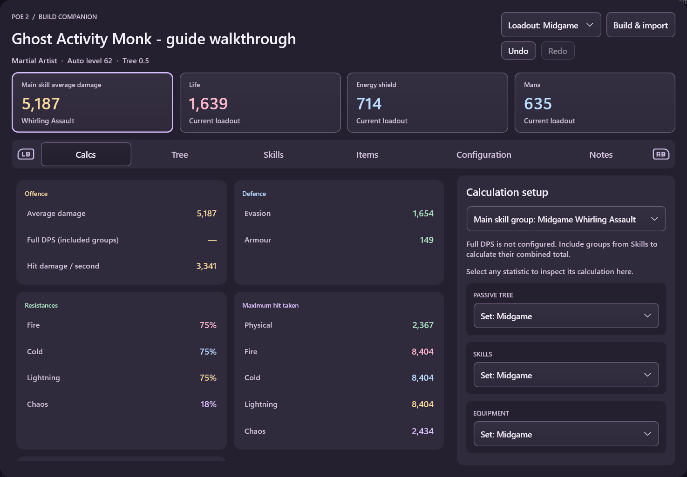

# Path of Building for WidgetRail

Plan and compare Path of Exile builds from your controller, inside the WidgetRail overlay.

Use **PoE1 Path of Building (Beta)** for Path of Exile or **PoE2 Path of Building (Beta)** for Path of Exile 2. Both use pinned Path of Building Community beta engines and their calculations.

*An example planning build. [See more screenshots and their context](screenshots/README.md).*

## What you can do

- Import a build and keep separate loadouts for different stages of your character.
- Edit skills, support gems, equipment, passives, and configuration.
- Preview tree and equipment changes before applying them, and undo saved edits.
- Inspect damage, defences, and the calculation breakdowns PoB provides.
- Browse the official trade website beside item comparisons and rank possible upgrades.
- Find similar items from a guide: select the modifiers you need and relax their roll requirements.
- Export PoB XML or share codes; PoE2 also supports in-game build-planner files.

## Get started

1. [Install WidgetRail](../../docs/users/getting-started.md), then open **Catalogue** and install the widget for your game. Installation requests full access so the widget can run its local PoB engine.
2. Open the widget and paste a **PoB share code** or **pobb.in link**, import an exported XML file, or create a new build.
3. Use **LB/RB** to switch sections. The on-screen controller guide shows the actions available for the current control. Keyboard and mouse also work.

Edits save automatically. Tree and equipment proposals use **Apply** or **Discard**; **Undo/Redo** is available in the build controls.

Focus or hover Undo/Redo to preview the change before applying it. The preview is
read-only; A or click still performs the action. Loadout switches remain part of history.

Item inventory, unique-item and gem candidates show their complete preview and controls on focus or hover.
Press **X** (or click the preview) to interact with its controls; **B** returns to
the same candidate without replacing the panel. **A** on the candidate keeps its usual select/add action.

The **Build** dropdown at the top switches between up to 20 recent builds. **All saved builds** opens the full library.

**Find similar** is available for equipped/inventory items, item drafts and either side of an equipment comparison. It uses PoB’s Buy similar filters; the guide item stays separate from the equipment used to evaluate results.

Each PoE widget remembers its last main tab across reloads. Pending comparisons or item drafts still reopen where you can finish them.

For a build on **poe.ninja** or **pob.cool**, copy its PoB code and use **Paste build from clipboard**. Direct poe.ninja profile-link import is unavailable, and pob.cool requires a mouse and keyboard.

## Learn more

These widgets cover build planning and comparison, with some desktop PoB features still unavailable. Choose the correct game when importing; older engines may not understand builds exported by a newer beta.

- [User guide](USER_GUIDE.md): imports, loadouts, editing, controller shortcuts, trade, and limitations.
- [Screenshots](screenshots/README.md): skills, passives, configuration, comparisons, and ranked results.
- [Developer documentation](DEVELOPMENT.md): engine compatibility, architecture, storage, building, and testing.

## Credits

Calculations and editing tools come from **Path of Building Community**, building on **Openarl's** original project. Path of Exile, its data, and its artwork belong to **Grinding Gear Games**. The planning screenshots use **Ghost Activity's** public Martial Artist guide. See [full credits and licensing](DEVELOPMENT.md#credits).

[PoB Redux](https://github.com/pobredux/pob-redux) inspired the gem-tag search, changed-configuration filtering, inline skill editing, unified search and build-comparison workflows. WidgetRail adapts those ideas for controller use; calculations and eligibility continue to come from PoB.
