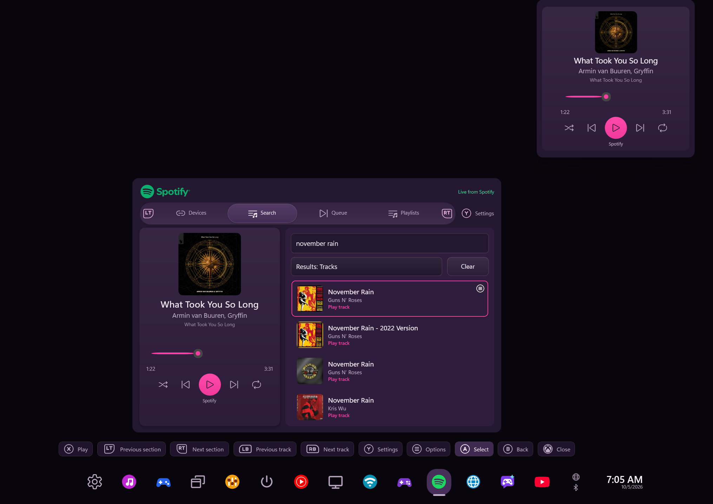
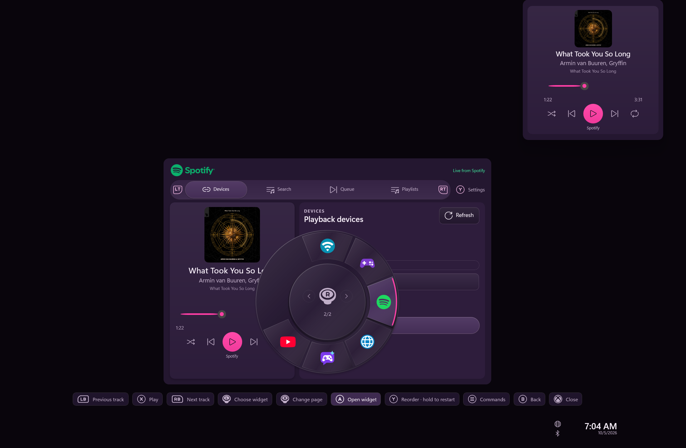

# Spotify

Find your next track and control your music from the overlay. Browse playlists,
manage playback on a Spotify device, or use **Play here** to listen through WidgetRail.



## What you can do

- Search for tracks, albums, artists, and playlists.
- Browse playlists and choose a track to start from.
- View the queue and add individual tracks to it. The separate now-playing panel stays visible.
- Save the current track to Liked Songs; track menus also provide Save and Remove actions.
- Get whole-search suggestions from recent searches and already-loaded music names, without extra Spotify searches.
- Switch playback devices or play locally through **This overlay**.
- Pin **Compact now playing** or **Now playing + up next** beside your game.

## Connect Spotify

You need a Spotify account and your own Spotify developer app. Spotify Premium is
required for Web Playback SDK streaming and Spotify's playback-control APIs.

1. Install Spotify from **Catalogue**, or install its `.wrwidget` from [WidgetRail releases](https://github.com/sandwi-dev/WidgetRail/releases) through **Settings → Widgets**. Review the full-access prompt. A fresh reviewed installation starts enabled; updating an existing installation preserves its enabled state.
2. Open **Setup** in the widget and create an app in the [Spotify Developer Dashboard](https://developer.spotify.com/dashboard).
3. Register this exact redirect URI in that app:

   ```text
   http://127.0.0.1:43827/callback/
   ```

4. Enter the app's **Client ID** in the widget. You do not need a Client Secret.
5. Select **Connect** and finish authorization in your browser.

Spotify's developer-mode restrictions still apply to your app and account. You can
return to the widget's Settings to replace the Client ID later.

**Open developer dashboard** uses a Windows-browser intent so WidgetRail waits
for controller release and its close animation before opening the page.

## Use it with a controller

Once connected, a fresh Spotify widget opens on **Devices**, where you can choose where to listen.
Use **LT / RT** to switch between Devices, Search, Queue, and Playlists. **A** activates
the focused control, **Y** opens Settings, and **B** returns from nested pages.
The on-screen guide shows playback and track-menu actions where available.

For local playback, open **Devices**, find **This overlay**, and select **Play here**.
The current WidgetRail installer includes the runtime needed by the local player.
While playing here, Now Playing updates directly from the local player. Playback
on another device is refreshed periodically through Spotify.



## Verify and disconnect

After connecting, open **Devices**, choose a playback device and try one track.
For WidgetRail playback, use **This overlay → Play here**. A saved Client ID or
successful installation alone does not verify streaming eligibility.

Use **Y → Settings** to reconnect or change the Client ID. **Disconnect account**
removes the saved authorization; authorize again to reconnect. You can also
revoke the developer app's access through your Spotify account.

Disabling keeps settings and the saved connection. Uninstalling removes
host-owned widget data, but the widget's Windows Credential Manager authorization
is separately stored. Disconnect before uninstalling if you want it removed.
Stopping WidgetRail's local player does not necessarily stop another Spotify device.

## Common questions

**Play here does not start.** Update WidgetRail as well as the Spotify widget.
The current player requires the hosted web-session service in the updated host.

**Where does local playback run?** WidgetRail hosts the player in its shared browser
runtime with an isolated private profile. No separate playback helper is started.
Your saved Spotify connection remains in the widget's existing credential store.

**Spotify rejects authorization.** Check the Client ID, the exact redirect URI,
and whether your Spotify app allows the account you're signing in with.

**Saving songs asks me to reconnect.** Reconnect in Settings to grant library read/write access. Existing playback grants do not include this permission.

**Can I remove a queued song?** Spotify does not expose a supported queue-removal API. The widget keeps the real Spotify queue rather than hiding entries locally.

**Why can't I add a whole playlist to the queue?** Add to queue is limited to
individual tracks. Adding an entire collection would require a separate request per track.

**Does switching pages repeatedly call Spotify?** Search results and loaded collections
are retained while the widget runs. Playlist pages also use a bounded disk cache and
Spotify's `snapshot_id` to check whether cached content is still current.

## Build or customize

From the repository root:

```powershell
pwsh -NoProfile -File .\samples\SpotifyWidget\Build-CommunityPackage.ps1 -Configuration Release
```

The package is written to `artifacts/community-addons/spotify/` without installing it.
See [development notes](DEVELOPMENT.md) for authorization, local playback, caching, and lifecycle details.

## Song banners and activity

Setup includes **Manage song notifications**, which opens the host's shared Song
changes category. It starts enabled for new installations; existing saved choices are preserved.
On/Off and opacity are saved by the host.
Banners show artwork, title, artist and duration, without adding pending entries.
Repeated position/pause updates do not replay them. Metadata updates are quiet.

Local-player events continue while this already-resident widget is hidden, without
adding a polling loop or changing residency. Cloud playback is observed through
the existing visible-widget refresh only: changing songs on another device while
WidgetRail hides Spotify does not trigger fresh cloud requests or reliable hidden
song notices. Opening the widget refreshes that state. Local sound and remote
playback use separate SDK activity sources; muted/paused local playback clears
local sound. Session teardown removes the event subscription and host activity.

The Song changes category declares banner-only retention. Its preferences offer
On/Off and banner opacity; there is no pending-list setting for song changes.
Value pickers focus the current setting, and B returns without changing it.
